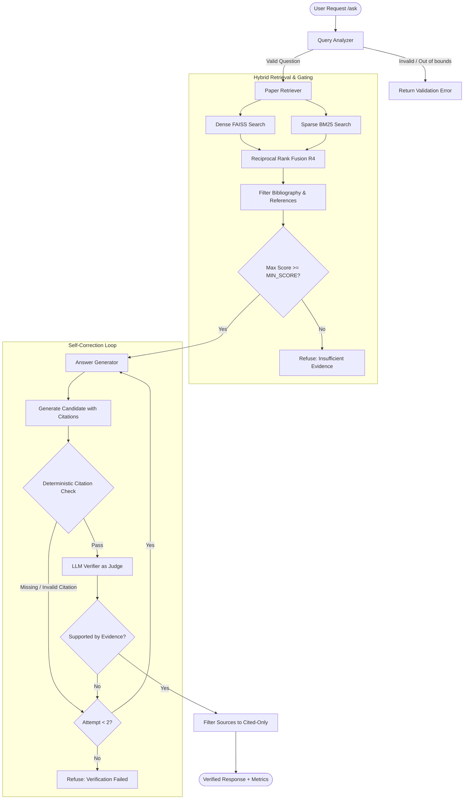
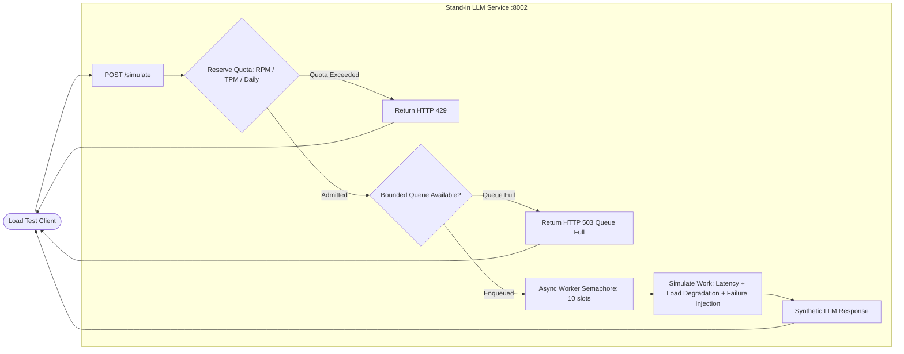
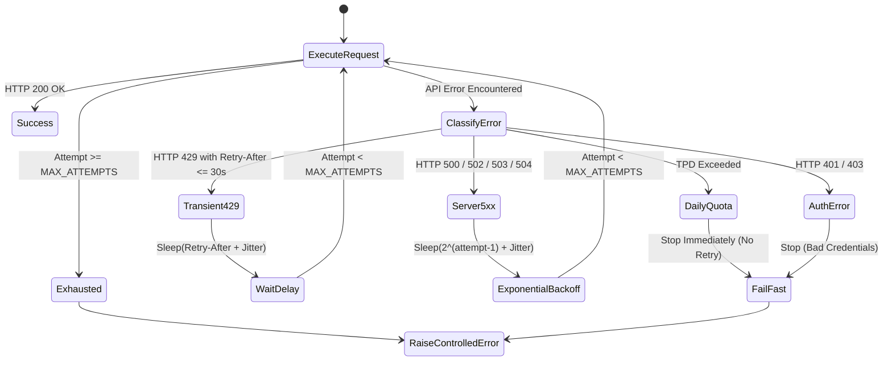

# The Relay: Research Paper Question-Answering System & LLM Operational Testbed

**The Relay** is an end-to-end, verification-driven Retrieval-Augmented Generation (RAG) system and operational testbed designed to answer complex technical questions strictly grounded in academic research papers. Built with **FastAPI**, **Groq** (`openai/gpt-oss-120b`), **FAISS**, **Sentence Transformers**, and **PyMuPDF**, the system enforces deterministic page-level citations, implements strict refusal semantics for unsupported or out-of-scope questions, and incorporates an automated LLM-as-a-judge verification loop with self-correction.

In addition to grounded question answering, The Relay includes an **operational resilience layer** for hosted LLMs (handling rate limits, transient server errors, and header-based backoff) and a **stand-in LLM simulator** (`simulator/`) designed to evaluate concurrency, request queueing, and quota exhaustion under realistic load profiles without burning production API quotas.

---

## Table of Contents

- [Key Capabilities](#key-capabilities)
- [System Architecture](#system-architecture)
  - [End-to-End Pipeline Flow](#end-to-end-pipeline-flow)
  - [Stand-in LLM Simulator Architecture](#stand-in-llm-simulator-architecture)
- [Included Research Papers](#included-research-papers)
- [Project Directory Structure](#project-directory-structure)
- [Multi-Strategy Retrieval System (R1 – R5)](#multi-strategy-retrieval-system-r1--r5)
  - [Strategy Comparison & Empirical Benchmarks](#strategy-comparison--empirical-benchmarks)
- [Operational Resilience & Groq Client](#operational-resilience--groq-client)
  - [Rate Limit Observations](#rate-limit-observations)
  - [Adaptive Retry & Error Classification](#adaptive-retry--error-classification)
- [Stand-in Simulator & Load Testing](#stand-in-simulator--load-testing)
  - [Simulated Operational Behaviors](#simulated-operational-behaviors)
  - [Automated Load Test Results](#automated-load-test-results)
- [Installation & Setup](#installation--setup)
  - [1. Clone Repository & Setup Environment](#1-clone-repository--setup-environment)
  - [2. Install Dependencies](#2-install-dependencies)
  - [3. Configure Environment Variables](#3-configure-environment-variables)
  - [4. Download Papers & Build Search Indexes](#4-download-papers--build-search-indexes)
- [Running the Application](#running-the-application)
  - [Starting the FastAPI Service](#starting-the-fastapi-service)
  - [API Endpoints & Examples](#api-endpoints--examples)
- [Running Experiments & Evaluations](#running-experiments--evaluations)
  - [Offline Unit Tests](#offline-unit-tests)
  - [Retrieval Evaluations](#retrieval-evaluations)
  - [Simulated Load Testing](#simulated-load-testing)
  - [Answer Quality & Refusal Benchmark](#answer-quality--refusal-benchmark)
  - [Token & Cost Analysis](#token--cost-analysis)
- [Configuration Reference](#configuration-reference)

---

## Key Capabilities

1. **Strict Page-Level Grounding & Citation Enforcement:**
   - Every factual paragraph in a generated answer must conclude with an exact bracketed citation (e.g., `[attention_is_all_you_need_v7.pdf, p. 5]`).
   - Uncited claims, invented page numbers, and citations drawn from reference/bibliography sections are rejected.
2. **Automated Verification & Self-Correction:**
   - Generated responses undergo dual verification: deterministic regex citation validation followed by an LLM-as-a-judge consistency audit against retrieved passages.
   - If an answer fails verification, the pipeline executes a single bounded correction attempt with verifier feedback.
3. **Principled Refusal Mechanics:**
   - If retrieved evidence falls below relevance thresholds or does not contain sufficient context, the pipeline gracefully declines to answer rather than hallucinating.
   - Out-of-scope queries (e.g., general knowledge, current events) are systematically refused.
4. **Multi-Strategy Hybrid Retrieval:**
   - Implements five distinct retrieval pipelines ranging from pure dense semantic search (FAISS) to BM25 keyword matching, Maximal Marginal Relevance (MMR), Reciprocal Rank Fusion (RRF) hybrid search, and Cross-Encoder neural reranking.
5. **Observability & Operational Resilience:**
   - Full instrumentation: per-request input/output tokens, generation latency, verification latency, time-to-first-token (TTFT), retrieval scores, and attempt logs.
   - Custom backoff engine respecting HTTP `Retry-After` and `x-ratelimit-reset-*` headers, preventing cascading failures.
6. **Realistic Load Simulation:**
   - Built-in local mock server with configurable tokens-per-minute (TPM), requests-per-minute (RPM), daily token budgets (TPD), worker concurrency, bounded queues, and failure injection.

---

## System Architecture

### End-to-End Pipeline Flow



### Stand-in LLM Simulator Architecture



---

## Included Research Papers

The system operates over a curated corpus of three landmark foundational papers in artificial intelligence, stored in `data/papers/`:

| Document Filename | Title | Primary Topics | arXiv Reference |
| :--- | :--- | :--- | :--- |
| `attention_is_all_you_need_v7.pdf` | **Attention Is All You Need** (Vaswani et al., 2017) | Transformer architecture, multi-head self-attention, positional encoding, scaled dot-product attention | [arXiv:1706.03762v7](https://arxiv.org/abs/1706.03762v7) |
| `moshi_v1.pdf` | **Moshi: a speech-text foundation model for real-time dialogue** (Défossez et al., 2024) | Real-time full-duplex speech-text dialogue, Mimi audio codec, streaming multi-stream transformer | [arXiv:2410.00037v1](https://arxiv.org/abs/2410.00037v1) |
| `dynamic_chunking_v2.pdf` | **Dynamic Chunking for Hierarchical Sequence Modeling** | Hierarchical sequence modeling, variable-length chunking vs. fixed-size chunking, long-context attention | [arXiv:2507.07955v2](https://arxiv.org/abs/2507.07955v2) |

---

## Project Directory Structure

```text
THE_RELAY/
├── data/
│   ├── papers/                         # Source research PDFs
│   │   ├── attention_is_all_you_need_v7.pdf
│   │   ├── dynamic_chunking_v2.pdf
│   │   └── moshi_v1.pdf
│   └── processed/                      # Chunked passages and search index
│       ├── chunks.jsonl                # Extracted text chunks with paper/page metadata
│       ├── metadata.json               # Chunk metadata mapped to FAISS vector IDs
│       └── paper_index.faiss           # Normalized FAISS IndexFlatIP index
│
├── pipeline/                           # Core RAG orchestration and Groq integration
│   ├── __init__.py
│   ├── answer_generator.py             # Prompt engineering and citation-bounded generation
│   ├── answer_verifier.py              # Regex citation check + JSON-schema LLM verification
│   ├── groq_client.py                  # Resilient API client with backoff and Retry-After parsing
│   ├── orchestrator.py                 # Multi-step pipeline coordinator with self-correction
│   └── query_analyzer.py               # Input validation, sanitization, and intent analysis
│
├── retrieval/                          # Text processing, vector indexing, and retrieval algorithms
│   ├── __init__.py
│   ├── chunking.py                     # Sliding-window page-aware text chunker
│   ├── embeddings.py                   # Dense vector generation (all-MiniLM-L6-v2) & FAISS indexing
│   ├── pdf_loader.py                   # PyMuPDF page extractor
│   └── retriever.py                    # R1–R5 retrieval engine (FAISS, BM25, MMR, RRF, Cross-Encoder)
│
├── simulator/                          # Local Stand-in LLM service for load testing
│   ├── __init__.py
│   ├── simulator_config.py             # Dataclass configuring rate limits, queues, latency, jitter
│   ├── standin_client.py               # HTTP and SSE client for the stand-in server
│   ├── standin_server.py               # FastAPI simulator with sliding-window quota tracker
│   └── test_load.py                    # Quick multi-threaded load generator
│
├── experiments/                        # Benchmark scripts and evaluation datasets
│   ├── analyze_results.py              # Computes latency percentiles (p50, p95, p99) and token totals
│   ├── evaluate_retrieval.py           # Automated evaluation of R1, R2, R3 retrieval
│   ├── inspect_retrieved_pages.py      # Debug tool inspecting extracted text against PDF pages
│   ├── retrieval_eval.csv              # Ground-truth queries with expected papers and pages
│   ├── run_load_tests.py               # Automated runner for Steady, Burst, Overload, RPM, and TPD tests
│   ├── test_retrieval.py               # Benchmark harness evaluating R1–R5 and hyperparameter sweeps
│   └── test_retrieval_before.py        # Baseline evaluation utility
│
├── results/                            # Experimental logs, markdown reports, and summary CSVs
│   ├── answer_quality_evaluation.csv   # 20-case test results (in-scope + out-of-scope queries)
│   ├── experiment_summary.csv          # Aggregate metrics from load testing
│   ├── groq_observations.md            # Live Groq API tier limits and findings
│   ├── load_test_results_final.csv     # Granular record of every simulated request
│   ├── load_test_summary_final.csv     # Scenario-level summary metrics
│   ├── peak_queue_summary.csv          # Queue depth and queue rejection measurements
│   ├── retrieval_summary_r4.csv        # Performance benchmarks for R4 hybrid retrieval
│   ├── retrieval_summary_reranking.csv # R4 vs. R5 Cross-Encoder comparison
│   ├── stage2_observations.md          # Live pipeline execution report
│   ├── stage3_simulator.md             # Stand-in service design and validation notes
│   └── stage4_results.md               # Automated load experiment findings
│
├── test/
│   └── test_groq_retry.py              # Offline unit tests for retry policy with mocked HTTP responses
│
├── download_papers.py                  # Downloads the three canonical PDFs from arXiv
├── evaluate_answers.py                 # Comprehensive answer quality and refusal evaluation suite
├── main.py                             # Main FastAPI production server (POST /ask, POST /ask/stream)
├── requirements.txt                    # Python project dependencies
├── test_groq.py                        # Sanity test script for live Groq API connectivity
├── test_pipeline.py                    # Multi-question pipeline demonstration script
└── tokens_per_answer+cost_per_1000.py  # Calculates cost projections per 1,000 queries
```

---

## Multi-Strategy Retrieval System (R1 – R5)

The retriever module (`retrieval/retriever.py`) supports five switchable strategies via the `RETRIEVAL_SETTING` environment variable:

- **R1 (Raw Semantic Search):** Top-$k$ nearest-neighbor search using FAISS with cosine similarity over `all-MiniLM-L6-v2` embeddings.
- **R2 (Filtered Semantic Search):** R1 search followed by deterministic heuristic filtering to exclude bibliography and reference sections (identifying reference headers and high density of citation brackets).
- **R3 (Maximal Marginal Relevance - MMR):** Balances relevance against redundancy among retrieved chunks ($\lambda = 0.75$).
- **R4 (Hybrid BM25 + FAISS with Reciprocal Rank Fusion - RRF):** Fuses sparse BM25 keyword rankings and dense FAISS semantic rankings using RRF ($k=60$), followed by reference filtering.
- **R5 (Cross-Encoder Neural Reranking):** Takes top candidate passages from R4 and scores query-passage pairs using a cross-encoder model (`cross-encoder/ms-marco-MiniLM-L-6-v2`).

### Strategy Comparison & Empirical Benchmarks

The strategies were evaluated on a benchmark of verified technical queries against ground-truth paper and page annotations (`experiments/retrieval_eval.csv`):

| Setting | Strategy Description | Hit@1 | Hit@3 | Hit@5 | Page Hit@5 | MRR | Avg Latency | p95 Latency |
| :---: | :--- | :---: | :---: | :---: | :---: | :---: | :---: | :---: |
| **R1** | Raw FAISS Semantic | 100.0% | 100.0% | 100.0% | 66.67% | 1.000 | **13.55 ms** | 16.26 ms |
| **R2** | FAISS + Reference Filtering | 100.0% | 100.0% | 100.0% | 66.67% | 1.000 | **21.51 ms** | 23.44 ms |
| **R3** | Maximal Marginal Relevance (MMR) | 100.0% | 100.0% | 100.0% | 60.00% | 1.000 | **37.86 ms** | 40.84 ms |
| **R4** | **Hybrid RRF (BM25 + FAISS) [Default]** | **100.0%** | **100.0%** | **100.0%** | **86.67%** | **1.000** | **25.22 ms** | **29.99 ms** |
| **R5** | R4 Hybrid + Cross-Encoder Reranking | 100.0% | 100.0% | 100.0% | 86.67% | 1.000 | 5,311.99 ms | 12,771.12 ms |

> [!TIP]
> **Why R4 is the Production Default:**
> While **R5** achieves an 86.67% page-level retrieval rate, the cross-encoder inference adds over **5 seconds** of latency per request. **R4 (Hybrid RRF)** achieves the exact same 86.67% page-level accuracy in only **25.2 ms**—a **210x speedup** with zero degradation in hit rate.

---

## Operational Resilience & Groq Client

### Rate Limit Observations

Under Groq's on-demand free tier for `openai/gpt-oss-120b`, observed headers established the following boundaries:
- **Tokens Per Minute (TPM):** 8,000
- **Requests Per Minute (RPM):** 1,000
- A full pipeline execution (generation + verification) requires between **3,500 and 4,200 tokens**. Under unconstrained concurrency, two simultaneous requests will breach the 8,000 TPM ceiling and trigger HTTP 429 (`rate_limit_exceeded`).

### Adaptive Retry & Error Classification

The custom client in `pipeline/groq_client.py` disables standard SDK retries (`max_retries=0`) in favor of an explicit, observable policy:



- **Fail-Fast on Daily Quota (TPD):** Identifies `"tokens per day"` exhaustion and refuses to retry fruitlessly.
- **Header Parsing:** Automatically extracts and respects `Retry-After`, `x-ratelimit-reset-tokens`, and `x-ratelimit-reset-requests`.
- **Bounded Context Windows:** Binds generation and verification context to $\le 4,500$ characters, capping token demand within provider limits.

---

## Stand-in Simulator & Load Testing

To evaluate traffic patterns that would immediately exhaust production quotas, The Relay incorporates an operational simulator (`simulator/standin_server.py`).

### Simulated Operational Behaviors

- **Sliding-Window Quota Tracking:** Atomic reservation of rolling RPM, TPM, and daily token budgets.
- **Worker Slot & Bounded Queue Model:** 10 concurrent worker slots backed by a bounded waiting queue of 20 slots. If the queue is saturated, requests fail fast with `HTTP 503 (Queue Full)`.
- **Load-Dependent Latency Degradation:** When minute token utilization exceeds 70%, request latency scales linearly up to $3\times$ baseline.
- **Configurable Fault Injection:** Probabilistic server crashes (HTTP 503) and synthetic timeouts (HTTP 504).
- **Synthetic SSE Streaming:** Emulates token streaming and measures time-to-first-token (TTFT).

### Automated Load Test Results

The load testing framework (`experiments/run_load_tests.py`) executed 675 requests across five distinct operational profiles:

| Scenario | Total Requests | Concurrent Workers | Success Rate | Mean Latency | p95 Latency | p99 Latency | Failure Modes Observed |
| :--- | :---: | :---: | :---: | :---: | :---: | :---: | :--- |
| **1. Steady Traffic** | 20 | 5 | **100.0%** | 307.76 ms | 347.40 ms | 347.45 ms | None (optimal conditions) |
| **2. Burst Traffic** | 30 | 30 | **100.0%** | 979.57 ms | 1,562.44 ms | 1,610.52 ms | Queueing delay; latency degradation |
| **3. Sustained Overload** | 100 | 20 | **54.0%** | 645.48 ms | 1,184.73 ms | 1,406.89 ms | 46 requests rejected (TPM exhausted) |
| **4. Halved RPM** | 510 | 50 | **98.04%** | 248.05 ms | 269.58 ms | 275.50 ms | 10 requests rejected at minute boundary |
| **5. Daily Budget Exhaustion** | 15 | 15 | **60.0%** | 56.14 ms | 59.06 ms | 59.60 ms | 6 requests rejected after quota hit zero |

---

## Installation & Setup

### 1. Clone Repository & Setup Environment

Ensure you have **Python 3.10+** (tested on Python 3.12) installed:

```bash
git clone https://github.com/your-username/THE_RELAY.git
cd THE_RELAY
```

Create and activate a virtual environment:

**Linux / macOS:**
```bash
python3 -m venv venv
source venv/bin/activate
```

**Windows (PowerShell):**
```powershell
python -m venv venv
.\venv\Scripts\Activate.ps1
```

### 2. Install Dependencies

```bash
pip install -r requirements.txt
```

### 3. Configure Environment Variables

Create a `.env` file in the project root:

```env
# Groq API Configuration
GROQ_API_KEY="gsk_your_groq_api_key_here"
GROQ_MODEL="openai/gpt-oss-120b"
GROQ_TIMEOUT=45

# Retrieval Configuration
RETRIEVAL_SETTING="R4"
RETRIEVAL_TOP_K=8
RETRIEVAL_CANDIDATE_K=50
MIN_RETRIEVAL_SCORE=0.25

# Evaluation & Retry Policy
EVALUATION_DELAY_SECONDS=45
GROQ_MAX_ATTEMPTS=3
GROQ_INITIAL_BACKOFF=2
GROQ_MAX_BACKOFF=30
GROQ_MAX_SERVER_WAIT=30
```

### 4. Download Papers & Build Search Indexes

Run the initialization scripts to download the papers, generate passage chunks, and build the FAISS index:

```bash
# 1. Download the three arXiv papers to data/papers/
python download_papers.py

# 2. Extract text and create page-aware chunks (500 words, 80 overlap)
python retrieval/chunking.py --chunk-size 500 --overlap 80

# 3. Generate dense embeddings and write data/processed/paper_index.faiss
python retrieval/embeddings.py
```

---

## Running the Application

### Starting the FastAPI Service

Start the production server via `uvicorn`:

```bash
uvicorn main:app --host 127.0.0.1 --port 8000 --reload
```

The server exposes interactive Swagger documentation at `http://127.0.0.1:8000/docs`.

### API Endpoints & Examples

#### 1. Ask Question (Synchronous)

`POST /ask`

```bash
curl -X POST "http://127.0.0.1:8000/ask" \
     -H "Content-Type: application/json" \
     -d '{"question": "How does multi-head attention work in the Transformer?"}'
```

**Sample JSON Response:**
```json
{
  "status": "ok",
  "question": "How does multi-head attention work in the Transformer?",
  "answer": "Multi-head attention allows the model to jointly attend to information from different representation subspaces at different positions. Instead of performing a single attention function with d_model-dimensional keys, values, and queries, the Transformer linearly projects the queries, keys, and values h times with different, learned linear projections to d_k, d_k, and d_v dimensions, respectively [attention_is_all_you_need_v7.pdf, p. 5].\n\nOn each of these projected versions of queries, keys, and values, the attention function is performed in parallel, yielding d_v-dimensional output values. These are concatenated and once again projected, resulting in the final values [attention_is_all_you_need_v7.pdf, p. 5].",
  "sources": [
    {
      "paper": "attention_is_all_you_need_v7.pdf",
      "page": 5
    }
  ],
  "verification": {
    "verified": true,
    "reason": "All factual claims and citations are supported",
    "unsupported_claims": []
  },
  "metrics": {
    "total_ms": 3120.45,
    "tokens_in": 3216,
    "tokens_out": 930,
    "total_tokens": 4146,
    "retries": 0,
    "generation_ms": 1840.12,
    "verification_ms": 1280.33,
    "retrieval_setting": "R4",
    "retrieval_top_k": 8,
    "retrieved_passages": 8,
    "best_retrieval_score": 0.5842
  }
}
```

#### 2. Ask Question (Server-Sent Events Streaming)

`POST /ask/stream`

```bash
curl -N -X POST "http://127.0.0.1:8000/ask/stream" \
     -H "Content-Type: application/json" \
     -d '{"question": "What is the Mimi audio codec in Moshi?"}'
```

Streams tokens in small chunks, concluding with a metadata payload containing sources, verification results, and token metrics.

#### 3. Health Check

`GET /health`

```bash
curl "http://127.0.0.1:8000/health"
```

---

## Running Experiments & Evaluations

### Offline Unit Tests

Run mock-based unit tests validating the custom Groq retry engine, backoff calculation, and fail-fast triggers:

```bash
python test/test_groq_retry.py
```

### Retrieval Evaluations

Benchmark the retrieval strategies across all queries:

```bash
# Evaluate R1, R2, and R3
python experiments/evaluate_retrieval.py

# Evaluate R4 and R5 with candidate sweeps
python experiments/test_retrieval.py --settings R4,R5 --top-k 8 --candidate-k 50
```

### Simulated Load Testing

1. Start the Stand-in Simulator in a separate terminal:
   ```bash
   uvicorn simulator.standin_server:app --port 8002
   ```

2. Run the automated multi-scenario load test suite:
   ```bash
   python experiments/run_load_tests.py
   ```

3. Analyze the results:
   ```bash
   python experiments/analyze_results.py
   ```
   Aggregated metrics will be saved in `results/experiment_summary.csv` and `results/peak_queue_summary.csv`.

### Answer Quality & Refusal Benchmark

Run the 20-case test suite evaluating in-scope factual accuracy and out-of-scope refusals:

```bash
python evaluate_answers.py
```

Outputs detailed execution logs and accuracy metrics to `results/answer_quality_evaluation.csv`.

### Token & Cost Analysis

Compute average token usage and operational cost projections per 1,000 queries:

```bash
python tokens_per_answer+cost_per_1000.py
```

---

## Configuration Reference

All settings can be configured via environment variables in `.env`:

| Variable | Default Value | Description |
| :--- | :---: | :--- |
| `GROQ_API_KEY` | *(Required)* | Groq API authentication key. |
| `GROQ_MODEL` | `openai/gpt-oss-120b` | Model name to target on the Groq endpoint. |
| `GROQ_TIMEOUT` | `45` | Maximum client timeout in seconds for Groq API calls. |
| `GROQ_MAX_ATTEMPTS` | `3` | Maximum retry attempts for transient API errors. |
| `GROQ_INITIAL_BACKOFF` | `2` | Initial exponential backoff delay in seconds. |
| `GROQ_MAX_BACKOFF` | `30` | Maximum cap on exponential backoff delay in seconds. |
| `GROQ_MAX_SERVER_WAIT` | `30` | Maximum allowable `Retry-After` delay before failing fast. |
| `RETRIEVAL_SETTING` | `R4` | Active retrieval strategy (`R1`, `R2`, `R3`, `R4`, `R5`). |
| `RETRIEVAL_TOP_K` | `8` | Number of top passages supplied to the generation context. |
| `RETRIEVAL_CANDIDATE_K` | `50` | Candidate pool size retrieved before ranking/filtering. |
| `MIN_RETRIEVAL_SCORE` | `0.25` | Relevance score cutoff; below this, queries are refused. |
| `EVALUATION_DELAY_SECONDS`| `45` | Delay between evaluation runs to avoid breaching TPM quotas. |

---

## License

This project is released under the **MIT License**.

