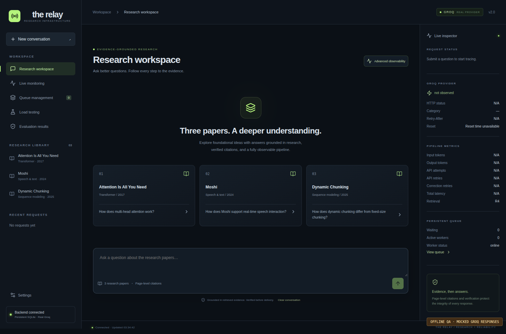
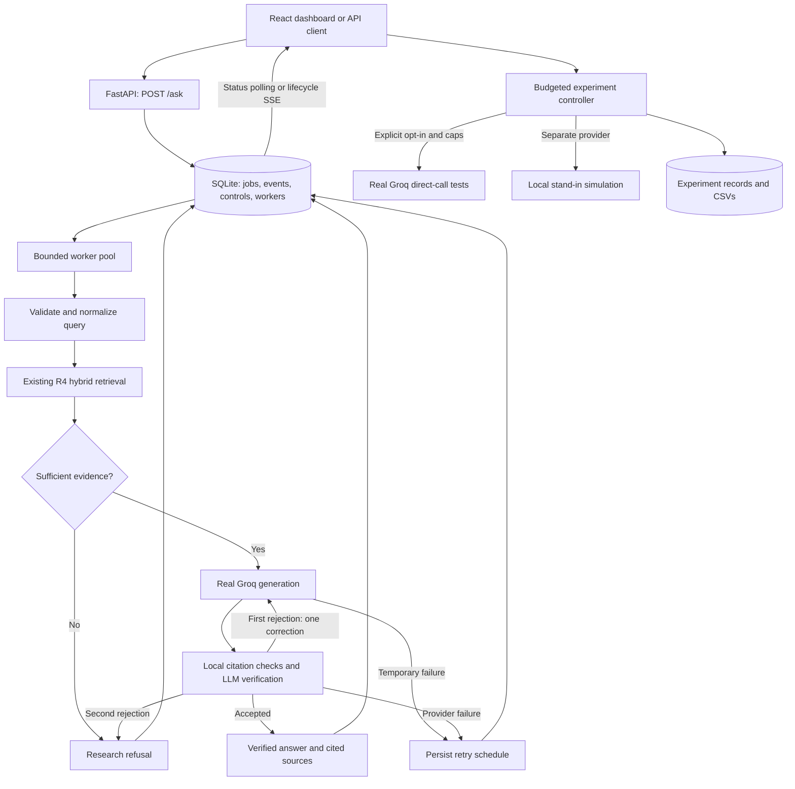

<div align="center">

# The Relay

### Research Paper QA & AI Reliability Platform

Evidence-grounded answers, persistent request scheduling, and an observable Groq workflow.

[](requirements.txt)
[](main.py)
[](frontend/package.json)
[](retrieval/retriever.py)
[](reliability/store.py)
[](pipeline/groq_client.py)
[](LICENSE)

</div>

The Relay answers questions about three research papers through an existing retrieval-augmented generation (RAG) pipeline. It retrieves page-aware evidence, generates an answer with Groq, validates citations, and checks factual support before returning the result. SQLite stores submitted questions so retryable API failures can be scheduled and resumed across application restarts.

The React dashboard connects to that backend and shows what happened: retrieval evidence, provider attempts, quota waits, verification outcomes, final answers, and queue state. Real Groq experiments and the local stand-in simulator have separate execution paths and reports.

**Current API:** `POST /ask` creates a persistent job and normally returns **HTTP 202**. Retrieve its outcome with `GET /jobs/{job_id}`. Optional synchronous waiting is available through `wait_seconds`; direct Python evaluation callers can still use `run_pipeline(question)`.

## Contents

- [Features](#features)
- [Research corpus](#research-corpus)
- [Quickstart](#quickstart)
- [Running the services](#running-the-services)
- [Dashboard](#dashboard)
- [Architecture](#architecture)
- [Retrieval and answer verification](#retrieval-and-answer-verification)
- [Persistent queue and database](#persistent-queue-and-database)
- [Retries and quota recovery](#retries-and-quota-recovery)
- [API reference](#api-reference)
- [Monitoring and logging](#monitoring-and-logging)
- [Controlled provider experiments](#controlled-provider-experiments)
- [Local stand-in simulator](#local-stand-in-simulator)
- [Configuration](#configuration)
- [Testing and validation](#testing-and-validation)
- [Evaluation and historical benchmarks](#evaluation-and-historical-benchmarks)
- [Security and deployment](#security-and-deployment)
- [Troubleshooting](#troubleshooting)
- [Repository structure](#repository-structure)
- [Limitations and future work](#limitations-and-future-work)
- [Contributing](#contributing)
- [License](#license)

## Features

| Capability | Implemented behavior |
| --- | --- |
| Research QA | Answers from retrieved paper passages; refuses when evidence is insufficient or verification fails. |
| Five retrieval strategies | Dense FAISS, reference filtering, MMR, hybrid BM25/FAISS RRF, and optional cross-encoder reranking. R4 is the application default. |
| Page-level citations | Checks cited paper/page pairs against retrieved metadata and requires citations in each paragraph. |
| Evidence verification | An LLM judge checks support after local citation validation; one correction attempt is allowed. |
| Persistent requests | SQLite stores questions, settings, states, attempts, retry times, operational events, and results. |
| Bounded workers | Configurable concurrency, atomic claims, renewable leases, stale-worker write protection, and crash recovery. |
| Quota-aware scheduling | Temporary failures and daily token exhaustion can defer jobs without continuously probing Groq. |
| Interactive dashboard | Research workspace, request inspector, queue management, monitoring, experiments, results downloads, and settings. |
| Live lifecycle | Durable backend events via incremental polling or SSE; timestamps and durations appear only when observed. |
| Controlled experiments | Dry-run by default; real tests require explicit opt-in, confirmation, and request/token/runtime budgets. |
| Isolated simulation | Local stand-in models quotas, worker capacity, queueing, latency degradation, and injected failures. |
| Offline tests | Mocked provider tests cover queue reliability, the existing RAG decisions, API behavior, budgets, and frontend states. |

## Research corpus

The downloader uses these versioned PDFs:

| Paper | Local filename | Topics |
| --- | --- | --- |
| Attention Is All You Need | `attention_is_all_you_need_v7.pdf` | Transformer, self-attention, multi-head attention, positional encoding |
| Moshi: a speech-text foundation model for real-time dialogue | `moshi_v1.pdf` | Speech/text generation, streaming dialogue, Mimi codec |
| Dynamic Chunking for End-to-End Hierarchical Sequence Modeling | `dynamic_chunking_v2.pdf` | Learned chunk boundaries and hierarchical sequence modeling |

Source URLs are defined in [download_papers.py](download_papers.py). Citations use the local filename and the **one-based PDF page**, which may differ from a printed page label:

```text
[attention_is_all_you_need_v7.pdf, p. 5]
```

## Quickstart

### 1. Prerequisites and installation

Use Python **3.10+**, Node.js **20.19+**, and npm. The recorded validation used Python 3.12 and Node.js 24. Commands below use a Bash-compatible shell and run from the repository root. A Groq API key is needed for real answers; mocked tests and the offline dashboard fixture do not require a valid key.

For an existing checkout, skip cloning and use its current repository directory.

```bash
git clone https://github.com/CYBERCONQUEROR/The-Relay.git
cd The-Relay

python3 -m venv venv
source venv/bin/activate
python -m pip install -r requirements.txt

npm --prefix frontend ci
```

Python dependencies are listed in [requirements.txt](requirements.txt); frontend dependencies are locked in [frontend/package-lock.json](frontend/package-lock.json). SQLite is provided by Python's standard library. Initial package installation, paper downloads, and uncached embedding/reranker models require network access.

### 2. Configure the environment

For a fresh checkout, copy the template. Preserve an existing `.env` if one is already configured.

```bash
cp .env.example .env
```

Edit `.env` with your own server-side key. Minimal local settings:

```dotenv
GROQ_API_KEY=your_groq_api_key_here
GROQ_MODEL=openai/gpt-oss-120b
RETRIEVAL_SETTING=R4
RETRIEVAL_TOP_K=8
RETRIEVAL_CANDIDATE_K=50
MIN_RETRIEVAL_SCORE=0.25
QUEUE_INLINE_WORKER=true
GROQ_LOAD_TEST_ENABLED=false
```

Do not put the Groq key in frontend files or `VITE_*` variables. The complete configuration is documented [below](#configuration) and in [.env.example](.env.example).

### 3. Prepare the corpus and index

If the matching PDFs, chunks, metadata, and FAISS index are already available, reuse them. Otherwise:

```bash
python download_papers.py
python retrieval/chunking.py --chunk-size 500 --overlap 80
python retrieval/embeddings.py
```

Expected artifacts:

```text
data/papers/                         # Three source PDFs
data/processed/chunks.jsonl           # Page-aware overlapping text chunks
data/processed/metadata.json          # Metadata matching vector positions
data/processed/paper_index.faiss      # Normalized dense-vector index
```

The chunker uses **word counts**, preserves PDF-page boundaries, and defaults to 500 words with 80 words of overlap. Rebuilding embeddings writes the index and its matching metadata; do this while workers are stopped rather than replacing a live corpus. The first model load may take longer if it must download weights.

### 4. Build and start

```bash
npm --prefix frontend run build
python -m uvicorn main:app --host 127.0.0.1 --port 8000
```

Open **http://127.0.0.1:8000**. FastAPI serves the built frontend, API, and default background worker. Request schemas are available at **http://127.0.0.1:8000/docs**.

Startup creates the database tables automatically. Retrieval initializes on the first processed research request; successful `/health` responses do not prove the index/model has loaded. Starting with an empty queue does not send Groq requests. Starting against an existing queue can resume eligible persisted jobs.

Ask a research question in the dashboard, or submit one with the [API examples](#submit-and-inspect-a-question).

## Running the services

| Service | Command from the repository root | Address |
| --- | --- | --- |
| Backend + built dashboard + inline worker | `python -m uvicorn main:app --host 127.0.0.1 --port 8000` | http://127.0.0.1:8000 |
| Frontend development server | `npm --prefix frontend run dev` | http://127.0.0.1:5173 |
| Separate queue worker | `python -m reliability.worker` | No HTTP port |
| Optional local stand-in | `python -m uvicorn simulator.standin_server:app --host 127.0.0.1 --port 8002` | http://127.0.0.1:8002 |
| Isolated mocked dashboard fixture | `python test/serve_mock_dashboard.py --port 8010` | http://127.0.0.1:8010 |

### Frontend development

Keep the backend running in one terminal and start Vite in another. Vite proxies `/ask`, `/jobs`, `/queue`, `/system`, `/health`, and `/experiments` to port 8000. After frontend changes, rebuild to update the dashboard served by FastAPI. Build before starting FastAPI if you want its static frontend mount; without `frontend/dist/`, `/` returns service information instead.

### Separate worker process

The inline worker is the default. To separate it from the API process:

```bash
# Terminal 1: API without its own worker
QUEUE_INLINE_WORKER=false python -m uvicorn main:app --host 127.0.0.1 --port 8000

# Terminal 2: independent worker
source venv/bin/activate
python -m reliability.worker
```

Both processes must use the same working directory, SQLite path, and queue settings. Default to one worker and one API process; all claimers must share the same `QUEUE_WORKERS` concurrency limit. The separate worker entry point uses POSIX signal handlers. Graceful shutdown stops new claims and allows active processing to finish; forced termination leaves jobs for lease-based recovery.

## Dashboard

| Page | Available controls and data |
| --- | --- |
| Research workspace | Submit with Send or Enter; Shift+Enter inserts a newline. Select example questions and saved requests, clear the current view, inspect answers and citations. |
| Advanced observability | See lifecycle stages, retrieved passages and scores, evidence decisions, API attempts, token usage, latency, verification, and an expandable operational log. |
| Simple chat view | Show the question, answer, citations, and current status without the advanced inspector. |
| Queue management | Live counts, job details, status filtering, job-ID search, pagination, refresh, and cancellation of eligible jobs. |
| Live monitoring | Queue/database/worker state, last-observed Groq outcomes, request status, latency distribution, token observations, and separately labeled stand-in metrics. |
| Load testing | Choose a provider and scenario, set budgets, validate a dry-run, review/confirm execution, stop future requests, and download CSV reports. |
| Evaluation results | Download existing result artifacts with their source labels. This page does not execute the legacy evaluation scripts. |
| Settings | Set the operator token and polling interval; inspect the status legend. |

The dashboard polls actual backend state every **2 seconds** by default; Settings supports 1–30 seconds. Event IDs deduplicate incremental updates. Failed connections retry and display a stale/disconnected notice. History comes from persisted jobs; conversations are independent questions, not multi-turn context supplied to the model.

Lifecycle stages cover request receipt, job creation, query analysis, retrieval, evidence checking, generation, citation verification, optional correction, final answer, and final status. Unrecorded stages are pending or skipped as appropriate. The browser does not invent successful stages, durations, or quota recovery.

### Screenshots

These screenshots come from the **offline QA fixture**, with mocked retrieval and mocked Groq HTTP responses. They demonstrate the interface and scheduler, not real provider performance or recovery.



| View | Screenshot |
| --- | --- |
| Persisted daily quota wait | [Quota waiting](docs/screenshots/quota-wait-desktop.png) |
| Answer, evidence, and lifecycle | [Completed request](docs/screenshots/completed-request-desktop.png) |
| Queue table and counters | [Queue management](docs/screenshots/queue-desktop.png) |
| System observations | [Monitoring](docs/screenshots/monitoring-desktop.png) |
| Explicit real-test approval | [Load-test confirmation](docs/screenshots/load-test-confirmation-desktop.png) |
| Responsive workspace | [Mobile](docs/screenshots/workspace-mobile.png) |

## Architecture



The simulator is not a fallback model. Real user jobs go through the existing orchestrator and Groq client. Provider experiments measure direct non-streaming calls; they do not measure the whole RAG workflow. Direct callers of `pipeline.orchestrator.run_pipeline(question)` retain their synchronous interface and do not automatically enter the persistent queue.

## Retrieval and answer verification

### Search strategies

| Setting | Strategy | Details |
| --- | --- | --- |
| `R1` | Dense FAISS | Normalized `all-MiniLM-L6-v2` embeddings and `IndexFlatIP`. |
| `R2` | Filtered dense search | Removes chunks heuristically identified as references/bibliography. |
| `R3` | MMR | Balances relevance and diversity; default lambda is 0.75. |
| `R4` | Hybrid BM25 + FAISS | Reciprocal Rank Fusion with constant 60, followed by reference filtering. Application default. |
| `R5` | Hybrid + cross-encoder | Reranks R4 candidates using `cross-encoder/ms-marco-MiniLM-L-6-v2`; loaded only when requested. |

The application defaults to 8 returned passages and a candidate pool of 50. The standalone retrieval API and experiment CLI have their own defaults; specify flags when comparing runs. R4 ranks by fusion score but supplies comparable dense cosine scores for confidence gating, including candidates found only through BM25. R5 retains those confidence scores while changing the ranking with a separate reranker score.

### Guarded answer workflow

1. Validate that the question is nonempty text of at most 2,000 characters. Query analysis currently returns a basic `research_question` intent; it is not an independent semantic scope classifier.
2. Retrieve evidence and compare the best relevance score with `MIN_RETRIEVAL_SCORE`.
3. Generate from a bounded evidence context. The prompt asks for concise paragraphs ending with exact paper/page citations.
4. Check that citation pairs match retrieved metadata and that every paragraph contains a citation.
5. Ask the verifier model whether claims are supported by the supplied evidence; validate its JSON verdict.
6. If verification fails, attempt one corrected generation and verification. If that also fails, return a refusal.
7. For accepted answers, expose only retrieved sources actually cited in the answer.

Citation checks are deterministic metadata checks; the support judgment is model-based and can be wrong. The system does not guarantee factual correctness or perfect out-of-domain detection. API outages are recorded separately from evidence-based refusals.

## Persistent queue and database

### Job states

| Status | Meaning | Can be cancelled? |
| --- | --- | --- |
| `pending` | Stored and awaiting eligibility/worker capacity. | Yes |
| `processing` | Claimed by a worker; retrieval or a provider call may be active. | No |
| `waiting_for_quota` | Daily token exhaustion detected; stored for a scheduled retry. | Yes |
| `retry_scheduled` | Temporary failure deferred until `next_run`. | Yes |
| `completed` | Pipeline returned an answer or a research refusal. | No |
| `failed` | Permanent error, unrecoverable pipeline failure, or attempt budget exhausted. | No |
| `cancelled` | A pending or scheduled job was cancelled before processing. | No further cancellation |

Scheduled jobs return to `processing` when eligible. A completed job's nested `result.status` distinguishes `ok`, `refused_correctly`, and `verification_failed`. Operational failure is a separate job state; `generation_failed` and invalid pipeline requests also become failed jobs.

### SQLite schema

| Table | Stored data |
| --- | --- |
| `jobs` | UUID `id`, question, status, `created`/`updated`, processing attempts, `next_run`, error category/message, JSON result and metadata, optional unique idempotency key, private lease/expiry/owner, first start, completion time, and `reset_estimated`. |
| `events` | Increasing integer event ID, job ID, timestamp, stage, state, and structured operational data. |
| `controls` | Shared `provider_not_before` cooldown timestamp for real-provider scheduling. |
| `workers` | Worker ID and last heartbeat. |
| `experiments` | Run configuration, status, per-attempt rows, summary, stop flag, deadline, and error/stop reason. |

The database defaults to `data/relay.sqlite3`. Timestamps are Unix UTC seconds, except load-test row timestamps, which are ISO UTC strings. The UI formats dates in the browser's locale.

WAL mode and `BEGIN IMMEDIATE` transactions protect active-capacity checks and claims across threads/processes. A renewable lease identifies the current worker; expired jobs can be reclaimed, and an old lease cannot overwrite a newer result. `QUEUE_CAPACITY` bounds **active** jobs, including quota waits. Completed history is retained and does not count toward that capacity.

Each job captures the model name, retrieval setting, top-k, candidate pool, confidence threshold, and pipeline version. Credentials are not part of the job snapshot. Corpus files, model artifacts, and dependency versions must be retained separately for reproducibility.

An `Idempotency-Key` deduplicates submissions with the same question and settings. Reusing it with different input/settings returns 409. This deduplicates local jobs; it does not guarantee one remote Groq call.

## Retries and quota recovery

There are three distinct attempt counters:

| Counter | Scope |
| --- | --- |
| Job `attempts` | Whole-pipeline executions, including interrupted executions recovered after a crash. Default maximum: 5. |
| Result `metrics.api_attempts` / `api_retries` | Groq client attempts/retries within that pipeline execution, across generation and verification. |
| Result `metrics.retries` | Verifier correction attempts; at most one per pipeline execution. |

The Groq SDK's automatic retries are disabled. The wrapper owns the policy: default three total attempts, 2-second initial exponential backoff, 30-second base cap, added jitter, and a maximum 30-second acceptable inline server wait. Jitter can add a small amount beyond the base cap.

| Failure | Client/queue behavior |
| --- | --- |
| Temporary RPM/TPM 429 with a short usable reset | Client can retry within its attempt/wait limits; an unresolved failure is scheduled persistently. |
| 429 with a long or missing reset | Avoid a long inline wait; queue the next attempt using supported reset information or the configured temporary fallback. |
| Daily token exhaustion (`daily_quota_exhausted`) | No immediate client retry. Persist `waiting_for_quota` with a supported reset or an explicitly estimated fallback. |
| 500/502/503/504 or connection/timeout | Bounded client retries, followed by queue scheduling if attempts remain. |
| 401/403 or permanent client error | Fail without automatic queue retries. |

Daily recovery uses explicit daily reset headers, Retry-After, or a provider retry-duration hint when available. Supported daily reset formats include relative duration, epoch, and ISO timestamps; Retry-After also supports HTTP dates. Generic minute token resets are not treated as proof of a daily reset. Without reliable daily information, the default **estimated** delay is 86,400 seconds, configurable through `QUEUE_QUOTA_FALLBACK_SECONDS`. No midnight reset is assumed.

While waiting, workers poll SQLite rather than Groq. A shared cooldown pauses new real RAG claims after a quota response. Reaching a retry timestamp only makes processing eligible; a successful actual provider response is required to emit confirmed `quota_recovery`. Repeated failures remain bounded by the job attempt limit. Failed jobs do not promise automatic completion.

**Execution is at least once.** A timeout can happen after the provider accepted a request, or a worker can crash after a billed response but before storing it. Reprocessing may duplicate provider calls and charges. A verification outage can also cause generation to be repeated on the next whole-job attempt. Cancellation cannot revoke a call already in progress.

## API reference

Protected endpoints require `Authorization: Bearer <operator-token>` when `RELAY_ADMIN_TOKEN` is configured. Without a token, local mode accepts loopback clients only. The examples below assume token-free loopback development; add the authorization header for a protected deployment.

### Endpoint catalog

| Method | Endpoint | Purpose |
| --- | --- | --- |
| `POST` | `/ask` | Create a job; optionally wait up to 30 seconds. |
| `GET` | `/jobs` | Paginated jobs with status filtering and job-ID search. |
| `GET` | `/jobs/{job_id}` | Current job state, error, settings, and available result. |
| `POST` | `/jobs/{job_id}/cancel` | Cancel an eligible pending/scheduled job. |
| `GET` | `/jobs/{job_id}/events` | Durable JSON event batches or SSE. |
| `POST` | `/ask/stream` | Compatibility SSE receipt followed by a final verified result or deferred state. |
| `GET` | `/queue/metrics` | Queue counts, worker status, waiting times, retry and provider observations. |
| `GET` | `/system/metrics` | Same dashboard-compatible metrics as `/queue/metrics`. |
| `GET` | `/system/health` | Database/worker state, last-observed Groq status, optional stand-in metrics. |
| `GET` | `/health` | Public liveness/database check; no Groq probe. |
| `POST` | `/experiments/run` | Validate a dry-run or admit a controlled experiment. |
| `GET` | `/experiments/results` | Recent experiment runs and existing root CSV artifact links. |
| `GET` | `/experiments/{run_id}` | Experiment state, rows, and summary. |
| `POST` | `/experiments/{run_id}/stop` | Prevent future experiment admissions; active calls may finish. |
| `GET` | `/experiments/{run_id}/csv` | Attempt CSV; use `?summary=true` for summary CSV. |
| `GET` | `/experiments/files/{filename}` | Download an existing root results CSV by basename. |

### Submit and inspect a question

```bash
curl -i http://127.0.0.1:8000/ask \
  -H 'Content-Type: application/json' \
  -H 'Idempotency-Key: attention-example-001' \
  -d '{"question":"How does multi-head attention work?"}'
```

New jobs normally return HTTP 202 and a `Location: /jobs/<job-id>` header. Illustrative response fields (actual responses include additional stored fields):

```json
{
  "id": "<job-id>",
  "job_id": "<job-id>",
  "question": "How does multi-head attention work?",
  "status": "pending",
  "attempts": 0,
  "result": null,
  "message": "Your request has been received."
}
```

Copy the returned ID into `JOB_ID`:

```bash
JOB_ID='<job-id>'
curl "http://127.0.0.1:8000/jobs/$JOB_ID"
curl 'http://127.0.0.1:8000/jobs?status=waiting_for_quota&limit=20&offset=0'
curl "http://127.0.0.1:8000/jobs?search=$JOB_ID"
curl -X POST "http://127.0.0.1:8000/jobs/$JOB_ID/cancel"
```

The job response includes status/message, timestamps, attempts, next execution time, `reset_estimated`, errors, parsed metadata, and any result. Private lease/owner/idempotency values are omitted. A completed result contains the original pipeline's answer, cited sources, verification verdict, attempts, and metrics. Public results strip raw verifier output and private reasoning fields. Read the nested `result.status` to distinguish accepted answers from research refusals.

`GET /jobs` returns `{items, total, limit, offset}`. `limit` is 1–100, default 25; `offset` is nonnegative. `status` accepts a job state from the table above; `search` matches an ID substring, up to 128 characters.

### Optional synchronous waiting

```bash
curl http://127.0.0.1:8000/ask \
  -H 'Content-Type: application/json' \
  -d '{"question":"Why does the Transformer use positional encoding?","wait_seconds":30}'
```

`question` must be nonblank and at most 2,000 characters. `wait_seconds` defaults to 0 and accepts 0–30. If processing completes in time, HTTP 200 returns the original pipeline result plus `job_id` and `job_status`. Otherwise it returns a job representation; active/deferred states use HTTP 202. A research refusal can be a completed pipeline result. A terminal failed/cancelled job representation can use HTTP 200; inspect its status rather than treating HTTP 200 as proof of an answer.

### Lifecycle polling and SSE

```bash
curl "http://127.0.0.1:8000/jobs/$JOB_ID/events?after=0"
curl -N "http://127.0.0.1:8000/jobs/$JOB_ID/events?stream=true&after=0"
```

JSON mode returns `{items: Event[]}` with up to 500 records. Each event has `id`, `job_id`, `timestamp`, `stage`, `state`, and `data`. Continue after the last ID to drain more records.

SSE uses `event: lifecycle`, an `id` cursor, JSON `data`, and heartbeat comments. Reconnect with `Last-Event-ID` or `after`; deduplicate by event ID. Streams close after all events for completed/failed/cancelled jobs are drained. Quota-waiting jobs can keep a lifecycle stream open. The durable database remains authoritative after disconnects or restarts.

`POST /ask/stream` accepts a question and emits a job receipt, then a completed answer or deferred state. It does not provide provider token streaming or TTFT, and does not support the `/ask` idempotency header behavior. Use `/jobs/{job_id}/events` for operational progress.

### Common HTTP outcomes

| Status | Meaning |
| --- | --- |
| `200` | Read/operation succeeded; inspect job or pipeline status for the actual outcome. |
| `202` | Accepted job is pending, processing, waiting for quota, or scheduled for retry. |
| `400` | Blank question, unknown status/cursor, conflicting experiment conditions, disabled execution, or invalid safety limits. |
| `401` | Configured operator token is missing/incorrect. |
| `404` | Job, run, or artifact not found. |
| `409` | Conflicting idempotency key or unsafe cancellation of an active/terminal job. |
| `422` | Request schema validation failed. |
| `503` | Active queue is full, or shared access requires server token configuration. |

A provider's HTTP 429 is recorded in job events/errors; it is not necessarily the HTTP status of the initial `/ask` response. A full queue returns 503 with `Retry-After: 5`.

## Monitoring and logging

```bash
curl http://127.0.0.1:8000/health
curl http://127.0.0.1:8000/system/health
curl http://127.0.0.1:8000/queue/metrics
```

`/health` checks SQLite and returns `status: healthy`, `database: available`, and `retrieval: loaded lazily on first request`. It does not initialize the index or call Groq.

Monitoring covers all job-state counts, total jobs, capacity, queue depth, oldest waiting age, mean first-claim wait, current processing count, worker heartbeat status, next scheduled retry, last successful observed Groq request, API success/failure/rate-limit counts, API retries, whole-job retries, latency mean/P50/P95, returned token totals, and available provider headers. Worker online status is based on a heartbeat within 15 seconds. `active_workers` counts processing jobs; `worker_processes` counts recent worker identities.

Provider health is **last observed**, not a continuous connectivity guarantee. `/system/health` makes no Groq probe; it can query the configured local stand-in `/metrics`. Unobserved metrics remain null/N/A. Queue API observations describe queued application calls; direct experiment metrics live in their run reports. Failed requests without returned usage can make token totals incomplete.

The dashboard charts persisted call outcomes, latency bins, observed token usage, current job distribution, and queue-depth samples collected during the browser session. Metrics responses expose the last 200 call observations, while aggregate calculations use retained history.

Structured operational logs and persisted events cover creation/admission, claims, processing, provider starts/results, limits, retry schedules, quota recovery, completion/failure, and expired-lease recovery. Job and provider request IDs support tracing. User questions and evidence are application data; protect database access. Credentials are redacted and are not included in execution settings or browser assets.

## Controlled provider experiments

### Scenarios and boundaries

[experiments/run_groq_load_tests.py](experiments/run_groq_load_tests.py) uses the reusable load runner. These are direct non-streaming provider calls with a small fixed prompt, separate from full RAG evaluation.

| Scenario | Behavior |
| --- | --- |
| `baseline` | Sequential requests for normal latency observations. |
| `low_concurrency` | Bounded simultaneous requests up to the configured concurrency. |
| `moderate_concurrency` | Gradually increases concurrency within the configured cap. |
| `rate_limit_observation` | Sequential observations; stops when a limit is seen. |
| `recovery` | Sequential, bounded retry after a short numeric provider Retry-After when remaining budgets allow it. |

CLI limits for maximum requests, estimated tokens, and runtime are required explicitly. Defaults are one concurrent request, 64 output tokens, and **dry-run**. Real Groq execution additionally requires `GROQ_LOAD_TEST_ENABLED=true`, `--live`, and `--confirm`; the API requires `dry_run=false`, `confirmed=true`, and explicit request/token/runtime fields. Backend environment caps apply even if frontend controls request larger values.

### Start with a dry-run

```bash
python experiments/run_groq_load_tests.py \
  --provider groq --scenario baseline \
  --max-requests 3 --max-tokens 2000 --max-runtime-seconds 30
```

This prints the effective configuration and reserved allowance without sending provider requests or generating measured-result CSVs.

### Explicitly approved real run

Only execute after reviewing the budget and intentionally approving quota use:

```bash
GROQ_LOAD_TEST_ENABLED=true python experiments/run_groq_load_tests.py \
  --provider groq --scenario baseline \
  --max-requests 3 --max-tokens 2000 --max-runtime-seconds 30 \
  --concurrency 1 --live --confirm
```

The CLI prints its configuration before sending requests. The dashboard uses **Validate dry run**, **Review & run**, and an explicit Groq approval checkbox. To allow dashboard live tests, set `GROQ_LOAD_TEST_ENABLED=true` in the backend environment and restart it. Live tests do not run on startup.

### Experiment API example

A safe validation request:

```bash
curl http://127.0.0.1:8000/experiments/run \
  -H 'Content-Type: application/json' \
  -d '{"provider":"groq","scenario":"baseline","max_requests":3,"concurrency":1,"max_tokens":2000,"max_runtime_seconds":30,"output_tokens":64,"dry_run":true,"confirmed":false}'
```

The returned run contains an ID, configuration, status, rows, summary, stop flag, deadline, and error/stop reason. Default API experiment values are stand-in/baseline, 5 requests, concurrency 1, 3,000 estimated tokens, 30 seconds, 64 output tokens, and dry-run. Real and stand-in API output caps are 256 tokens per attempt.

Run statuses are `dry_run`, `running`, `completed`, `stopped`, `interrupted`, and `failed`. `/experiments/results` lists the latest 100 persisted runs plus root CSV artifact links.

```bash
RUN_ID='<run-id>'
curl "http://127.0.0.1:8000/experiments/$RUN_ID"
curl -X POST "http://127.0.0.1:8000/experiments/$RUN_ID/stop"
curl "http://127.0.0.1:8000/experiments/$RUN_ID/csv" -o run-results.csv
curl "http://127.0.0.1:8000/experiments/$RUN_ID/csv?summary=true" -o run-summary.csv
```

### Budgets, stopping, and provider separation

Every physical HTTP attempt reserves one request and an estimated token allowance of UTF-8 prompt bytes + 256 overhead + the output cap before network access. Retries consume the same budgets. This conservative estimate is a safety budget, not an exact billing guarantee; actual returned usage is recorded separately.

A 429 stops the run unless `recovery` has a numeric Retry-After of at most 30 seconds, fewer than three total recovery attempts, and sufficient remaining time/budget. Missing reset information stops observation. Daily exhaustion and permanent client/auth errors stop future calls. Tests never resume automatically after a reset or restart. Runtime limits constrain request waits; stopping cannot revoke a provider call already accepted, and concurrent in-flight requests may still finish after a limit is detected.

The API admits one active experiment at a time. Groq experiments are rejected while active queue jobs or a recorded provider cooldown exist; new RAG claims pause while an API-controlled real experiment runs. The standalone CLI does not join that gate: drain/stop your application's real work before using it. Other programs sharing the key are outside this coordination.

### CSV outputs and metrics

New measured runs write unique directories; existing outputs are not overwritten by the new runner:

```text
results/groq/<run-uuid>/results.csv
results/groq/<run-uuid>/summary.csv
results/standin/<run-uuid>/results.csv
results/standin/<run-uuid>/summary.csv
```

The CLI also accepts `--output-dir` pointing to a new directory. API-controlled runs persist records in SQLite and offer live progress/downloads. Interrupted runs are marked interrupted after their recorded deadline; they do not restart themselves.

Per-attempt CSV fields include provider, request ID, scenario, timestamp, HTTP status, success, error category, input/output/total tokens, latency, retries, optional queue/API processing time, rate-limit/reset headers, Retry-After, model, completion-after-retry flag, and observed concurrency. **TTFT is unavailable** because these tests are non-streaming.

Summary CSVs include success/failure/rate-limit counts and percentages, latency mean/median/P95/P99, average token usage, returned token totals, usage completeness, average retries, maximum observed concurrency, and queue-wait statistics when measured. `token_usage_complete=false` means total consumption is only a lower bound from available responses. Missing values are not estimated into measurements. New rows explicitly identify `provider=groq` or `provider=standin`; legacy simulator CSVs use `source=standin`.

## Local stand-in simulator

The simulator is optional and does not consume Groq quota:

```bash
python -m uvicorn simulator.standin_server:app --host 127.0.0.1 --port 8002
```

Default simulation settings are 10 execution slots, a 20-position waiting queue, an 8-second request deadline, 1,200 ms base latency with jitter, failure/timeout injection, and load-dependent degradation up to 3×. Simulated quotas default to 30 RPM, 8,000 TPM, 1,000 requests/day, and 200,000 tokens/day. These are **simulator configuration**, not a statement of your live Groq account limits. The simulator's daily counters reset through its reset operation; they are not proof of real provider reset behavior.

| Method | Simulator endpoint | Purpose |
| --- | --- | --- |
| `GET` | `/health`, `/metrics` | Simulator liveness and simulated counters. |
| `POST` | `/simulate` | Synthetic response with simulated latency, usage, and queue wait. |
| `POST` | `/simulate/stream` | Synthetic SSE; any TTFT is a simulation measurement. |
| `POST` | `/configure` | Update simulation settings; execution-slot changes require an idle service. |
| `POST` | `/reset` | Reset simulator counters. |

Example measured simulation using the bounded runner (`--live` here means execute the selected provider, which is **stand-in**):

```bash
python experiments/run_groq_load_tests.py \
  --provider standin --scenario low_concurrency \
  --max-requests 5 --concurrency 2 --max-tokens 3000 \
  --max-runtime-seconds 30 --live --confirm
```

No Groq enable flag is needed for stand-in execution. Its runner caps are 1,000 requests, concurrency 100, 1,000,000 estimated tokens, and 600 seconds. Keep the simulator on loopback; its control routes are separate from the main application's operator protection.

The older `experiments/run_load_tests.py` still operates on port 8002, reconfigures/resets the stand-in, and writes fixed filenames such as `results/results1.csv` and `results/peak_queue_summary.csv`. Preserve existing artifacts before intentionally rerunning that legacy experiment. It imports `requests`, which may need a separate `python -m pip install requests`. `experiments/analyze_results.py` reads `results/results.csv`; it does not automatically select the newer run directories.

## Configuration

Use [.env.example](.env.example) as the complete template. Backend and standalone worker load `.env`; explicit process environment variables take precedence. Restart the relevant processes after changing settings. Queue numeric limits must be positive, and `QUEUE_WORKERS` must be 1–16. Use the same settings across processes sharing a queue.

### Groq and retrieval

| Variable | Default | Meaning |
| --- | --- | --- |
| `GROQ_API_KEY` | Unset | Required for real generation/verification. Never sent to the browser. |
| `GROQ_MODEL` | `openai/gpt-oss-120b` | Generation/verifier model, captured with each queued job. |
| `GROQ_TIMEOUT` | `45` | Groq SDK request timeout in seconds. |
| `GROQ_MAX_ATTEMPTS` | `3` | Total client attempts per completion, including the initial call. |
| `GROQ_INITIAL_BACKOFF` | `2` | Initial exponential backoff base in seconds. |
| `GROQ_MAX_BACKOFF` | `30` | Maximum exponential base; jitter is added. |
| `GROQ_MAX_SERVER_WAIT` | `30` | Largest acceptable inline provider-requested wait in seconds. |
| `RETRIEVAL_SETTING` | `R4` | Application strategy: R1–R5. |
| `RETRIEVAL_TOP_K` | `8` | Passages returned to the pipeline. |
| `RETRIEVAL_CANDIDATE_K` | `50` | Candidate pool for filtered/hybrid/diverse/reranked retrieval. |
| `MIN_RETRIEVAL_SCORE` | `0.25` | Minimum best relevance score for generation. |
| `EVALUATION_DELAY_SECONDS` | `45` | Delay between manual answer-evaluation cases. |

### Persistent queue and worker

| Variable | Default | Meaning |
| --- | --- | --- |
| `QUEUE_DATABASE` | `data/relay.sqlite3` | SQLite file path; use durable local storage. |
| `QUEUE_CAPACITY` | `200` | Maximum active persisted jobs, including waiting/retry jobs. |
| `QUEUE_WORKERS` | `1` | Shared concurrent processing limit. |
| `QUEUE_POLL_SECONDS` | `1` | Eligibility polling interval against SQLite. |
| `QUEUE_LEASE_SECONDS` | `120` | Processing lease; heartbeat renewals occur at least every 5 seconds. |
| `QUEUE_MAX_ATTEMPTS` | `5` | Whole-job execution limit, including interrupted attempts. |
| `QUEUE_QUOTA_FALLBACK_SECONDS` | `86400` | Estimated daily retry delay without reliable reset information. |
| `QUEUE_RETRY_SECONDS` | `30` | Temporary failure fallback delay without a usable reset. |
| `QUEUE_INLINE_WORKER` | `true` | Start workers inside FastAPI; set false for a separate worker process. |

### Access and integration

| Variable | Default | Meaning |
| --- | --- | --- |
| `RELAY_LOCAL_MODE` | `true` | Allow token-free protected routes for loopback clients only. |
| `RELAY_ADMIN_TOKEN` | Empty | Shared operator bearer token; required for shared access. |
| `CORS_ORIGINS` | `http://localhost:5173,http://127.0.0.1:5173` | Comma-separated permitted browser origins. |
| `STANDIN_URL` | `http://127.0.0.1:8002` | Optional stand-in address used by the backend/runner. |

### Real Groq experiment caps

| Variable | Default | Meaning |
| --- | --- | --- |
| `GROQ_LOAD_TEST_ENABLED` | `false` | Enables explicit, confirmed real tests; does not start a test. |
| `GROQ_LOAD_TEST_MAX_REQUESTS` | `20` | Maximum physical HTTP attempts per run, including retries. |
| `GROQ_LOAD_TEST_MAX_CONCURRENCY` | `2` | Maximum simultaneous real test calls. |
| `GROQ_LOAD_TEST_MAX_TOKENS` | `10000` | Maximum reserved estimated token allowance. |
| `GROQ_LOAD_TEST_MAX_RUNTIME_SECONDS` | `300` | Maximum run duration. |

These are application safety settings, not published Groq quotas. Actual limits depend on the account/model and available provider responses.

## Testing and validation

### Offline automated checks

```bash
python -m unittest discover -s test -v
npm --prefix frontend test
npm --prefix frontend run build
```

The recorded implementation validation passed **38 backend tests**, **13 frontend tests**, TypeScript checking, and the Vite production build. These counts describe the implementation record; rerun the commands to validate your checkout/environment.

Backend coverage includes original retry behavior, real SDK handling over mocked HTTP, 401/403 and 5xx errors, citation checks, evidence refusal, the one correction attempt, persistent queue/restart behavior, lease recovery/fencing, concurrent submissions/claims, capacity, idempotency, cancellation, quota scheduling/resumption, experiment budgets/CSV output, access controls, API startup, and standalone worker startup/shutdown. Frontend tests mock the API for answers/citations/refusals, retry/quota/failure/resumption states, polling recovery, queue controls, provider distinction, and explicit load-test approval.

Normal automated checks do not consume Groq quota. Do not use broad root-level discovery as a substitute: root `test_groq.py` and `test_pipeline.py` are manual scripts that make live calls, and some experiment modules execute on import.

### Exercise the full dashboard without real quota

```bash
npm --prefix frontend run build
python test/serve_mock_dashboard.py --port 8010
```

Open http://127.0.0.1:8010 and submit a question. The explicit fixture owns a temporary database, mocks retrieval and Groq HTTP, and returns an initial daily quota response with a 4-second retry hint. The existing orchestrator then resumes, generates, verifies, and stores a visibly labeled **OFFLINE TEST** answer. The fixture never replaces production `main.py`. If an operator token is configured, enter it in Settings as usual.

Optional browser QA uses [frontend/tests/browser-smoke.cjs](frontend/tests/browser-smoke.cjs) with an installed Playwright module and Chromium:

```bash
RELAY_PLAYWRIGHT_MODULE=/absolute/path/to/playwright \
RELAY_CHROMIUM_PATH=/usr/bin/chromium \
node frontend/tests/browser-smoke.cjs
```

Start a fresh fixture before this script so its first call enters quota waiting. It checks desktop/mobile behavior, quota waiting and answer delivery, citations, queue navigation, the approval gate, JavaScript errors, and horizontal overflow; screenshots are written under `docs/screenshots/`. This does not verify real Groq recovery.

Set the optional `RELAY_QA_URL` if the fixture uses a different address; the browser script defaults to `http://127.0.0.1:8010`.

## Evaluation and historical benchmarks

### Retrieval experiments

The retrieval harness has 15 built-in queries across the three papers. It measures paper Hit@1/3/5, reciprocal rank, page hits, and retrieval latency. To create a separately named run:

```bash
python experiments/test_retrieval.py \
  --settings R1,R2,R3,R4 --top-k 5 --candidate-k 50 \
  --lambda-value 0.75 --suffix my_new_run
```

Outputs are `results/retrieval_evaluation_my_new_run.csv` and `results/retrieval_summary_my_new_run.csv`. Choose an unused suffix; these older evaluation scripts write fixed paths for the selected suffix. Add R5 only when you want its additional model load and reranking cost. Retrieval experiments do not call Groq but can download uncached local models.

The harness's `page_hit_at_5` name is historical: its current calculation checks page numbers across the returned result set, does not also match the expected paper in that check, and does not enforce five results if a different top-k is selected. Interpret page-hit values alongside the script, paper-hit metrics, and run configuration. [experiments/evaluate_retrieval.py](experiments/evaluate_retrieval.py) is a separate legacy evaluator using [experiments/retrieval_eval.csv](experiments/retrieval_eval.csv).

Archived retrieval results:

| Setting | Queries | Paper Hit@1/3/5 | Recorded page-hit % | MRR | Mean latency | P95 latency | Artifact |
| --- | --- | --- | --- | --- | --- | --- | --- |
| R1 | 15 | 100% / 100% / 100% | 66.67 | 1.000 | 13.554 ms | 16.261 ms | [Baseline summary](results/retrieval_summary.csv) |
| R2 | 15 | 100% / 100% / 100% | 66.67 | 1.000 | 21.509 ms | 23.437 ms | [Baseline summary](results/retrieval_summary.csv) |
| R3 | 15 | 100% / 100% / 100% | 60.00 | 1.000 | 37.861 ms | 40.844 ms | [Baseline summary](results/retrieval_summary.csv) |
| R4 | 15 | 100% / 100% / 100% | 86.67 | 1.000 | 25.218 ms | 29.993 ms | [Reranking comparison](results/retrieval_summary_reranking.csv) |
| R5 | 15 | 100% / 100% / 100% | 86.67 | 1.000 | 5,311.988 ms | 12,771.123 ms | [Reranking comparison](results/retrieval_summary_reranking.csv) |

These rows combine separate archived experiments; inspect their configurations before comparing them. In the archived R4/R5 comparison, R4 retained the recorded page-hit result with much lower retrieval latency, motivating the default. This is not a measured whole-system throughput guarantee, and the table was not regenerated after the queue/dashboard upgrade.

### Historical stand-in load results

The following figures come from [results/load_test_results_final.csv](results/load_test_results_final.csv), which contains 675 rows labeled `source=standin`. Mean/P95 below include **all recorded request latencies**, including rejected requests.

| Scenario | Requests | Successful | Success rate | Mean latency | P95 latency |
| --- | --- | --- | --- | --- | --- |
| Steady | 20 | 20 | 100.00% | 307.76 ms | 347.40 ms |
| Burst | 30 | 30 | 100.00% | 979.57 ms | 1,562.44 ms |
| Sustained overload | 100 | 54 | 54.00% | 349.44 ms | 1,012.52 ms |
| Halved RPM | 510 | 500 | 98.04% | 243.34 ms | 269.55 ms |
| Daily budget exhausted | 15 | 9 | 60.00% | 36.32 ms | 58.56 ms |

These are simulator observations under those runs' configuration, not live Groq performance. Fast rejections reduce all-request latency; successful-request latency is a different statistic. Recorded simulation limits may differ from current simulator defaults.

### Answer quality evaluation

[evaluate_answers.py](evaluate_answers.py) calls the real synchronous RAG pipeline and writes `results/answer_quality_evaluation78.csv`. Review its `TEST_CASES`, output filename, and pacing before deliberately running it: the current file enables one out-of-scope case and leaves many other cases commented out. Do not assume a full 20-question suite executes by default.

Existing answer-quality CSVs are retained as historical artifacts. They do not establish universal citation accuracy, refusal accuracy, or provider reliability. No live Groq test or quota-recovery measurement was run as part of the recorded queue/dashboard validation.

## Security and deployment

The application currently supports **one trusted operator**, not separate user accounts or tenant ownership.

- Bind local development to `127.0.0.1`. Without an operator token, protected routes accept only loopback clients while `RELAY_LOCAL_MODE=true`.
- For shared deployment, set a strong `RELAY_ADMIN_TOKEN`, set `RELAY_LOCAL_MODE=false`, use HTTPS, and restrict CORS origins. Send the token as `Authorization: Bearer ...`; dashboard Settings stores it in sessionStorage.
- The Groq key remains server-side. No credentials are included in job settings, frontend bundles, or normal operational records.
- A proxy can make external clients appear local; configure operator authentication before placing one in front of the app. CORS is not authentication.
- Protect the queue database, corpus, logs, and CSVs: they contain questions, evidence, answers, and operational information. Job IDs are not a multi-user authorization boundary.
- Use a durable local disk with working SQLite locks/WAL. Deployments on network/removable filesystems should select a suitable absolute `QUEUE_DATABASE` path.
- Preserve the database across restarts and use SQLite's backup API or a consistent stopped-service backup; copying only the main file during active WAL writes can omit recent state. Retained history requires an explicit archival plan.
- Keep the stand-in's configuration/reset endpoints on a trusted local interface. Main-app token protection does not automatically protect that separate service.

The current Python dependency list is not version-pinned. Record the installed dependency/model/corpus versions when producing reproducible deployments or benchmarks.

## Troubleshooting

| Symptom | Check or action |
| --- | --- |
| `/` returns JSON instead of the dashboard | Build `frontend/dist/`, then restart FastAPI so the static frontend mount is created. |
| Dashboard reports disconnected | Confirm backend port 8000, Vite proxy configuration, CORS origin, and Settings token. Inspect `/health`. |
| Requests return 401 | Supply the configured operator token; it is different from the Groq key. |
| Protected routes return 503 about shared access | Configure `RELAY_ADMIN_TOKEN` or use a genuine loopback client in local mode. |
| Jobs stay pending and worker is offline | Start the inline worker or `python -m reliability.worker`; verify shared database path/settings. |
| Worker is online but jobs wait | Check `next_run`, quota cooldown, active capacity, or an admitted real-provider experiment. |
| Queue is full | Inspect waiting jobs and scheduled retries; cancel eligible obsolete jobs or adjust the bounded capacity intentionally. |
| FAISS index or metadata is missing/mismatched | Run ingestion/chunking/embeddings from the repository root while workers are stopped; keep matching artifacts together. |
| First retrieval is slow or a model cannot load | Check model cache/network access. R5 needs an additional cross-encoder; health checks do not preload either model. |
| Job is waiting for quota with an estimated reset | Groq supplied no reliable daily reset. The configurable fallback is only a retry estimate; inspect the next real response. |
| Job failed after repeated retries | Inspect `attempts`, error category/message, and events. Permanent/exhausted jobs do not auto-resume; fix the cause before a new submission. |
| Real load test is rejected | Check enable flag, explicit confirmation/budgets, environment caps, queue activity, existing run, and recorded cooldown. |
| Stand-in health is unavailable | Start the optional simulator on port 8002 or set the correct server-side `STANDIN_URL`. Real QA does not need the simulator. |
| SQLite reports locking or write errors | Check writable local storage and locking support; keep transactions/process settings consistent and stop workers before maintenance. |
| Charts show N/A | No qualifying observation exists, or the provider did not return that measurement. TTFT is unavailable for non-streaming tests. |
| Legacy simulation script cannot import `requests` | Install its extra dependency; this script is separate from the new httpx-based bounded runner. |

Do not delete a queue database to clear a quota condition: that would discard the persisted work the recovery system is designed to preserve.

## Repository structure

```text
The-Relay/
├── main.py                         # FastAPI entry point
├── requirements.txt                # Python dependencies
├── .env.example                    # Complete server configuration template
├── data/
│   ├── papers/                     # Source PDFs
│   ├── processed/                  # Chunks, metadata, FAISS index
│   └── relay.sqlite3               # Local runtime queue; ignored by Git
├── retrieval/
│   ├── pdf_loader.py               # One-based PDF-page extraction
│   ├── chunking.py                 # Word-based overlapping chunks
│   ├── embeddings.py               # Normalized embeddings and FAISS index
│   └── retriever.py                # R1–R5 strategies and confidence scores
├── pipeline/
│   ├── query_analyzer.py           # Input validation and normalization
│   ├── orchestrator.py             # Existing guarded RAG pipeline
│   ├── answer_generator.py         # Evidence-bounded generation prompts
│   ├── answer_verifier.py          # Citation checks and LLM support verdict
│   └── groq_client.py              # SDK client, retry policy, provider telemetry
├── reliability/
│   ├── config.py                   # Queue environment settings
│   ├── store.py                    # SQLite schema, claims, events, metrics
│   ├── worker.py                   # Bounded processing and retry scheduling
│   ├── telemetry.py                # Context-local tracing and redaction
│   ├── api.py                      # Jobs, lifecycle, health, monitoring, UI hosting
│   ├── load_testing.py             # Provider budgets and measurements
│   └── experiments.py              # Experiment admission, persistence, reports
├── frontend/
│   ├── src/                        # React/TypeScript dashboard, API client, styles
│   ├── tests/                      # Mocked UI tests and optional browser checks
│   ├── package.json                # Development/build/test commands
│   ├── package-lock.json           # Locked frontend dependency graph
│   ├── vite.config.ts              # Development API proxy and test setup
│   └── dist/                       # Generated frontend build; ignored by Git
├── simulator/                      # Separate synthetic LLM service and clients
├── experiments/
│   ├── run_groq_load_tests.py       # Budgeted Groq/stand-in CLI; dry-run default
│   ├── run_load_tests.py            # Legacy local simulator scenarios
│   ├── test_retrieval.py            # Configurable retrieval evaluation
│   ├── retrieval_eval.csv           # Legacy retrieval ground truth
│   └── ...                         # Additional evaluators and inspection scripts
├── test/                           # Offline backend suites and mocked UI server
├── results/                        # Historical CSVs/reports and unique new run folders
├── docs/
│   ├── RELIABILITY.md              # Focused queue and operations guide
│   ├── IMPLEMENTATION.md           # Changed files and validation record
│   └── screenshots/                # Labeled offline QA captures
├── download_papers.py              # Versioned corpus download
├── evaluate_answers.py             # Explicit manual live RAG evaluation
├── test_groq.py                    # Manual real-provider smoke script
├── test_pipeline.py                # Manual real RAG questions
└── LICENSE                         # MIT license
```

## Limitations and future work

- **Single-host queue:** SQLite is the initial backend. A queue protocol boundary exists, but no Redis backend or distributed execution system is supplied.
- **At-least-once calls:** Leases and idempotency protect local state, not provider exactly-once billing. Persisted generation checkpoints or provider-supported idempotency could reduce duplicates.
- **Estimated resets and budgets:** A fallback timestamp does not prove quota recovery; estimated token allowances do not establish exact billed usage.
- **Single operator:** Multi-user identity, job ownership, tenant isolation, and per-user budgets require additional implementation.
- **Retention and scale:** Jobs/events/results remain available without automatic archival. Metrics currently aggregate retained events; large histories need indexed rollups and retention controls.
- **Bounded evidence:** Generation and verification use character-limited evidence contexts. Retrieval/citation matching and an LLM judge cannot guarantee correctness.
- **Observability limits:** Health is last-observed, queue-depth chart history is browser-session data, and the compatibility answer stream does not measure provider TTFT.
- **Reproducibility:** Job settings are captured, but immutable corpus/model snapshots and pinned Python dependencies are not yet managed by the queue.
- **Experiment coordination:** API-controlled tests coordinate with this SQLite queue. External clients and the standalone CLI using the same API key are outside that gate.
- **No live validation claim:** The recorded tests and screenshots use mocks. Real throughput, account-specific limits, and actual quota recovery require a separately approved live run.

See [docs/RELIABILITY.md](docs/RELIABILITY.md) for the focused operating guide and [docs/IMPLEMENTATION.md](docs/IMPLEMENTATION.md) for the implementation/file inventory and recorded checks.

## Contributing

Make focused changes inside the existing architecture. Preserve the direct pipeline entry point, citation workflow, separation of simulation from real Groq, and distinction between API retries and verifier corrections. Add meaningful mocked tests for changed reliability behavior, run the offline backend/frontend checks, and include relevant validation in pull requests.

Do not commit `.env`, credentials, runtime queue databases, frontend dependencies, or generated frontend builds. Do not replace archived experiment data as part of an unrelated change. Any live provider experiment should be deliberate, explicitly approved, bounded, and identified in its report.

## License

The Relay is available under the [MIT License](LICENSE).
