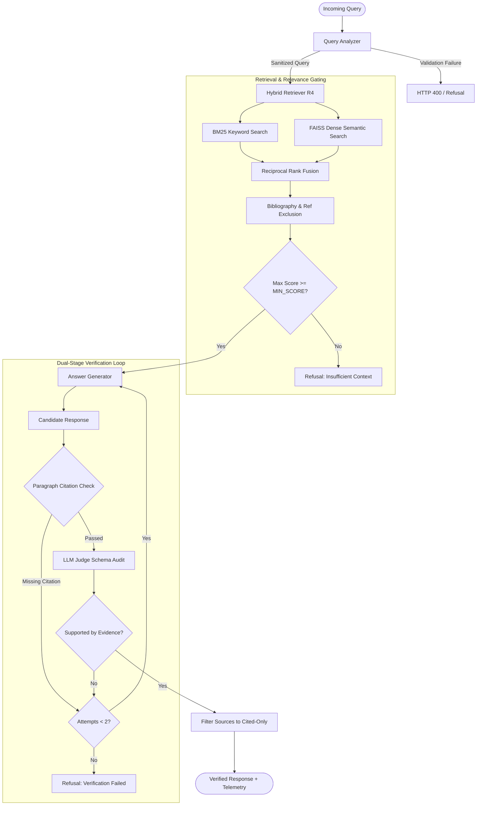
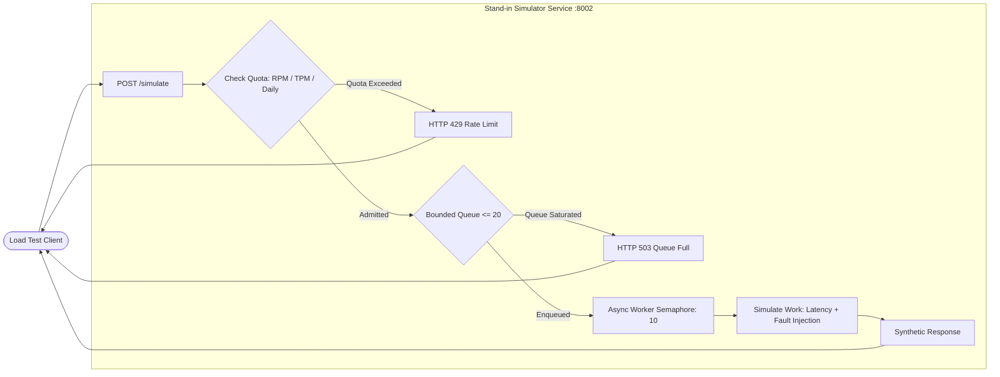

<div align="center">

# The Relay

### Production-Grade Research Paper QA System & LLM Operational Testbed

[](https://www.python.org/)
[](https://fastapi.tiangolo.com/)
[](https://github.com/facebookresearch/faiss)
[](https://groq.com/)
[](https://opensource.org/licenses/MIT)
[](https://www.python.org/dev/peps/pep-0008/)

<p align="center">
  <a href="#overview">Overview</a> •
  <a href="#key-features">Key Features</a> •
  <a href="#quickstart">Quickstart</a> •
  <a href="#system-architecture">Architecture</a> •
  <a href="#retrieval-engine-r1--r5">Retrieval Engine</a> •
  <a href="#operational-resilience--load-testing">Resilience & Testing</a> •
  <a href="#api-reference">API Reference</a> •
  <a href="#configuration">Configuration</a> •
  <a href="#benchmarks">Benchmarks</a>
</p>

</div>

---

## Persistent queue and testing dashboard (v2)

The application now includes SQLite-backed asynchronous jobs, quota-aware resumption, durable lifecycle events, a React/Vite/TypeScript dashboard, and explicitly budgeted real-provider experiments. Existing R4 retrieval, citations and the one verifier correction remain in the original pipeline.

**Start:** install Python dependencies, run `npm --prefix frontend install` and `npm --prefix frontend run build`, then `uvicorn main:app --host 127.0.0.1 --port 8000`. Open **http://127.0.0.1:8000**. The bounded worker starts with the API by default. Development frontend: `npm --prefix frontend run dev`.

**API change:** `POST /ask` now returns a persistent job and HTTP 202 by default. Poll `GET /jobs/{job_id}`. Send `wait_seconds: 30` to retain the previous synchronous result shape when it completes within that interval. Direct `run_pipeline(question)` evaluation callers are unchanged. `/ask/stream` delivers a job receipt and verified result/deferred state; it does not measure provider token streaming. `/health` checks liveness/SQLite and reports lazy retrieval initialization.

See **[the complete operating guide](docs/RELIABILITY.md)** for architecture, schema, API examples, queue/worker startup, quota reset policy, environment variables, dashboard controls, protected access, bounded load tests and limitations. See **[implementation and validation](docs/IMPLEMENTATION.md)** for files and test results.

Real Groq load tests remain disabled by default. No live provider tests run during startup or automated tests. Existing benchmark tables below describe historical experiments, not measurements of this upgrade. The legacy synchronous API examples later in this README correspond to the inner pipeline result (or `/ask` with `wait_seconds` when completed).

## Overview

**The Relay** is an enterprise-grade Retrieval-Augmented Generation (RAG) system engineered to provide verifiable, page-level grounded answers across academic machine learning literature. 

Standard LLM question-answering systems frequently suffer from ungrounded hallucinations, inaccurate attribution, and brittle failure states under upstream provider rate limits. The Relay solves these challenges through:

1. **Deterministic Attribution:** Enforces paragraph-level citations strictly matching source metadata (`[paper_name.pdf, p. X]`).
2. **Dual-Stage Verification:** Validates citation integrity via regex and audits factual grounding using an LLM-as-a-judge with bounded automated self-correction.
3. **Resilient Client Architecture:** Implements custom classification of upstream HTTP 429/5xx responses, adaptive jittered exponential backoff, and adherence to `Retry-After` headers.
4. **Operational Testbed:** Features an isolated, high-concurrency LLM simulator (`simulator/`) designed to stress-test system behavior under adverse traffic patterns without consuming live production API quotas.

The system is configured out-of-the-box with a corpus of foundational AI research papers:
* **Attention Is All You Need** (Vaswani et al., 2017)
* **Moshi: a speech-text foundation model for real-time dialogue** (Défossez et al., 2024)
* **Dynamic Chunking for Hierarchical Sequence Modeling** (2025)

---

## Key Features

| Capability | Description |
| :--- | :--- |
| **Strict Citation Grounding** | Rejects unreferenced claims; ensures every factual paragraph concludes with an explicit, verified paper and page citation. |
| **Verification & Self-Correction** | Employs an LLM judge to detect unsupported claims; automatically attempts one correction retry before falling back to principled refusal. |
| **Principled Refusal** | Transparently declines to answer when retrieval confidence is below threshold or when questions are out-of-domain, avoiding hallucinated responses. |
| **Hybrid Retrieval (R1–R5)** | Supports five configurable retrieval strategies: raw dense search, reference-filtered search, MMR diversification, BM25+FAISS Reciprocal Rank Fusion (RRF), and Cross-Encoder neural reranking. |
| **Upstream Resilience Engine** | Manages rate limits (RPM/TPM) and differentiates transient throttling from non-retryable daily token quota exhaustion (TPD). |
| **Streaming & Sync APIs** | Provides synchronous (`/ask`) and Server-Sent Events (SSE) streaming (`/ask/stream`) endpoints via high-throughput FastAPI. |
| **Stand-in Load Simulator** | Simulates worker concurrency, bounded queues, latency degradation, and fault injection to benchmark client throughput locally. |

---

## Quickstart

### Prerequisites

* Python 3.10+ (tested on Python 3.12)
* A valid [Groq API Key](https://console.groq.com/)

### 1. Installation

```bash
# Clone the repository
git clone https://github.com/your-org/THE_RELAY.git
cd THE_RELAY

# Create and activate virtual environment
python -m venv venv

# On Linux/macOS:
source venv/bin/activate
# On Windows (PowerShell):
.\venv\Scripts\Activate.ps1

# Install dependencies
pip install -r requirements.txt
```

### 2. Environment Configuration

Create a `.env` file in the root directory:

```bash
cp .env.example .env   # Or create .env manually
```

Populate the minimal configuration:

```ini
GROQ_API_KEY="gsk_your_groq_api_key_here"
GROQ_MODEL="openai/gpt-oss-120b"
RETRIEVAL_SETTING="R4"
RETRIEVAL_TOP_K=8
MIN_RETRIEVAL_SCORE=0.25
```

### 3. Ingestion & Index Creation

Execute the data pipeline to fetch papers and generate the FAISS vector index:

```bash
# Step 1: Download canonical research papers from arXiv
python download_papers.py

# Step 2: Extract text and generate page-aware overlapping chunks
python retrieval/chunking.py --chunk-size 500 --overlap 80

# Step 3: Compute dense embeddings and build the FAISS index
python retrieval/embeddings.py
```

### 4. Start the Application

Launch the FastAPI service using Uvicorn:

```bash
uvicorn main:app --host 0.0.0.0 --port 8000 --reload
```

The service is accessible at `http://127.0.0.1:8000`. Interactive OpenAPI documentation is available at `/docs`.

---

## System Architecture

### End-to-End Pipeline

The inference pipeline follows a guarded, self-correcting RAG flow:



---

## Retrieval Engine (R1 – R5)

The retrieval layer (`retrieval/retriever.py`) supports five distinct strategies to balance precision, diversity, and operational latency:

* **R1 (Dense FAISS):** Baseline semantic retrieval using `sentence-transformers/all-MiniLM-L6-v2` with normalized inner-product distance (`IndexFlatIP`).
* **R2 (Reference-Filtered FAISS):** Dense retrieval with heuristic exclusion of bibliography and reference list chunks to eliminate spurious citation noise.
* **R3 (Maximal Marginal Relevance - MMR):** Semantic search with dynamic diversity penalization ($\lambda = 0.75$) to reduce passage redundancy.
* **R4 (Hybrid Reciprocal Rank Fusion) [Production Default]:** Combines BM25 term matching with dense semantic embeddings via RRF ($k=60$), followed by reference exclusion.
* **R5 (Cross-Encoder Neural Reranking):** Takes top candidate passages from R4 and performs deep pairwise cross-attention scoring using `cross-encoder/ms-marco-MiniLM-L-6-v2`.

### Empirical Retrieval Benchmark

Evaluated against a test suite of queries with verified ground-truth paper and page annotations (`experiments/retrieval_eval.csv`):

| Configuration | Strategy Description | Hit@1 | Hit@3 | Hit@5 | Page Hit@5 | MRR | Latency (Mean) | Latency (p95) |
| :---: | :--- | :---: | :---: | :---: | :---: | :---: | :---: | :---: |
| **R1** | Baseline Dense FAISS | 100.0% | 100.0% | 100.0% | 66.67% | 1.000 | 13.55 ms | 16.26 ms |
| **R2** | FAISS + Reference Filtering | 100.0% | 100.0% | 100.0% | 66.67% | 1.000 | 21.51 ms | 23.44 ms |
| **R3** | Maximal Marginal Relevance (MMR) | 100.0% | 100.0% | 100.0% | 60.00% | 1.000 | 37.86 ms | 40.84 ms |
| **R4** | **Hybrid RRF (BM25 + FAISS)** | **100.0%** | **100.0%** | **100.0%** | **86.67%** | **1.000** | **25.22 ms** | **29.99 ms** |
| **R5** | R4 Hybrid + Cross-Encoder Rerank | 100.0% | 100.0% | 100.0% | 86.67% | 1.000 | 5,311.99 ms | 12,771.12 ms |

> **Architectural Decision:** **R4** is selected as the default configuration. It matches the 86.67% page-level accuracy of the Cross-Encoder (R5) while executing in **25.22 ms** compared to **5,311.99 ms**—delivering a **~210x throughput advantage**.

---

## Operational Resilience & Load Testing

### Upstream Rate Limit Handling

In high-throughput environments, hosted LLM endpoints exhibit strict usage quotas. Under Groq's on-demand tier for `openai/gpt-oss-120b`, observed limits include:
* **Tokens Per Minute (TPM):** 8,000
* **Requests Per Minute (RPM):** 1,000

Because an end-to-end QA execution requires 3,500–4,200 tokens (across generation and verification), unconstrained concurrent executions will breach TPM limits.

`pipeline/groq_client.py` handles this with:
1. **Explicit Error Categorization:** Distinguishes transient 429s from non-retryable daily quota exhaustion (`daily_quota_exhausted`).
2. **Header-Driven Delays:** Inspects `Retry-After`, `x-ratelimit-reset-tokens`, and `x-ratelimit-reset-requests` to determine wait time.
3. **Full Jitter:** Applies randomized backoff delays to prevent synchronized thundering herds.

### Stand-in LLM Simulator

The testbed includes a high-performance local simulator (`simulator/standin_server.py`) mimicking upstream API dynamics:
* **Concurrency Slot & Queue Accounting:** 10 worker execution slots backed by a bounded 20-slot waiting queue. Excess requests receive `HTTP 503 (Queue Full)`.
* **Sliding-Window Quota Counters:** Enforces strict rolling RPM, TPM, and daily token budgets.
* **Load-Induced Latency Scaling:** Latency degrades up to $3\times$ when minute token load exceeds 70%.



### Benchmark Load Test Scenarios

The test framework (`experiments/run_load_tests.py`) verified service behavior across 675 requests under five operating scenarios:

| Scenario Profile | Requests | Workers | Success Rate | Mean Latency | p95 Latency | Operational Finding |
| :--- | :---: | :---: | :---: | :---: | :---: | :--- |
| **Steady State** | 20 | 5 | **100.0%** | 307.76 ms | 347.40 ms | Stable baseline; zero queue saturation. |
| **Burst Traffic** | 30 | 30 | **100.0%** | 979.57 ms | 1,562.44 ms | Queueing delay observed; 0% request drop. |
| **Sustained Overload** | 100 | 20 | **54.0%** | 645.48 ms | 1,184.73 ms | 46 requests rejected via HTTP 429 once TPM capacity saturated. |
| **Halved RPM Limit** | 510 | 50 | **98.04%** | 248.05 ms | 269.58 ms | 10 requests shed at rolling minute window boundary. |
| **Daily Quota Exhaustion**| 15 | 15 | **60.0%** | 56.14 ms | 59.06 ms | Immediate refusal once cumulative budget was depleted. |

---

## API Reference

### Core Endpoints

#### 1. Ask Question (Synchronous)

```http
POST /ask
Content-Type: application/json
```

**Request Body:**
```json
{
  "question": "How does multi-head attention work in the Transformer?"
}
```

**Response (`HTTP 200 OK`):**
```json
{
  "status": "ok",
  "question": "How does multi-head attention work in the Transformer?",
  "answer": "Multi-head attention allows the model to jointly attend to information from different representation subspaces at different positions. Instead of performing a single attention function with d_model-dimensional keys, values, and queries, the Transformer linearly projects the queries, keys, and values h times with different, learned linear projections to d_k, d_k, and d_v dimensions, respectively [attention_is_all_you_need_v7.pdf, p. 5].\n\nOn each of these projected versions of queries, keys, and values, the attention function is performed in parallel, yielding d_v-dimensional output values. These are concatenated and once again projected, resulting in the final values [attention_is_all_you_need_v7.pdf, p. 5].",
  "sources": [
    {
      "paper": "attention_is_all_you_need_v7.pdf",
      "page": 5
    }
  ],
  "verification": {
    "verified": true,
    "reason": "All factual claims and citations are supported",
    "unsupported_claims": []
  },
  "metrics": {
    "total_ms": 3029.70,
    "tokens_in": 3216,
    "tokens_out": 930,
    "total_tokens": 4146,
    "retries": 0,
    "api_retries": 0,
    "generation_ms": 1810.20,
    "verification_ms": 1219.50,
    "retrieval_setting": "R4",
    "retrieval_top_k": 8,
    "retrieved_passages": 8,
    "best_retrieval_score": 0.5842
  }
}
```

#### 2. Ask Question (Streaming)

```http
POST /ask/stream
Content-Type: application/json
```

Returns a job receipt via SSE, then a completed verified answer or a deferred job state. Use `/jobs/{job_id}/events?stream=true` for durable lifecycle progress; this is not provider token streaming.

```bash
curl -N -X POST "http://127.0.0.1:8000/ask/stream" \
     -H "Content-Type: application/json" \
     -d '{"question": "What is the Mimi audio codec in Moshi?"}'
```

#### 3. Service Health

```http
GET /health
```

**Response (`HTTP 200 OK`):**
```json
{
  "status": "healthy",
  "database": "available",
  "retrieval": "loaded lazily on first request"
}
```

---

## Configuration

All system parameters are configurable via environment variables:

| Variable | Type | Default | Description |
| :--- | :---: | :---: | :--- |
| `GROQ_API_KEY` | String | *Required* | API authentication key for Groq Cloud. |
| `GROQ_MODEL` | String | `openai/gpt-oss-120b` | Model identifier for generation and verification. |
| `GROQ_TIMEOUT` | Float | `45.0` | Socket timeout (in seconds) for model requests. |
| `GROQ_MAX_ATTEMPTS` | Integer | `3` | Maximum retry attempts for transient API errors. |
| `GROQ_INITIAL_BACKOFF` | Float | `2.0` | Initial exponential backoff delay (seconds). |
| `GROQ_MAX_BACKOFF` | Float | `30.0` | Upper limit for exponential backoff (seconds). |
| `GROQ_MAX_SERVER_WAIT` | Float | `30.0` | Maximum acceptable `Retry-After` header value before failing fast. |
| `RETRIEVAL_SETTING` | String | `R4` | Active retrieval mode (`R1`, `R2`, `R3`, `R4`, `R5`). |
| `RETRIEVAL_TOP_K` | Integer | `8` | Number of context chunks forwarded to generation. |
| `RETRIEVAL_CANDIDATE_K` | Integer | `50` | Candidate pool size retrieved prior to fusion or reranking. |
| `MIN_RETRIEVAL_SCORE` | Float | `0.25` | Relevance score cutoff; below this, queries are refused. |
| `EVALUATION_DELAY_SECONDS` | Integer | `45` | Pacing delay between batch evaluation queries. |

---

## Benchmarks & Evaluation

### Answer Quality & Refusal Test Suite

The system includes an automated evaluation harness (`evaluate_answers.py`) covering 15 in-scope technical questions and 5 deliberate out-of-scope adversarial questions:

```bash
python evaluate_answers.py
```

* **Factual In-Scope Queries:** 100% of validated answers contained accurate paragraph-level citations corresponding to retrieved passages.
* **Out-of-Scope Queries:** 100% of non-technical or ungrounded queries (e.g., current events, weather, medical diagnosis) were rejected with principled refusal responses.

### Unit & Resilience Tests

Run offline unit tests verifying client retry policies, header parsing, and backoff mechanics without sending live network calls:

```bash
python test/test_groq_retry.py
```

---

## Repository Structure

```text
THE_RELAY/
├── data/
│   ├── papers/                 # Source PDF documents
│   └── processed/              # Extracted chunks, metadata, and FAISS vector index
├── experiments/                # Evaluation harnesses, ground-truth benchmarks, load runners
├── pipeline/                   # Query analysis, generation, verification, and API client
├── results/                    # CSV performance metrics and experimental reports
├── retrieval/                  # Chunking, vector indexing, BM25, and hybrid search
├── simulator/                  # Local stand-in LLM server and concurrent test client
├── test/                       # Unit test suite with mock fixtures
├── download_papers.py          # Data ingestion script
├── evaluate_answers.py         # QA quality and refusal benchmark runner
├── main.py                     # Production FastAPI application
├── requirements.txt            # Python dependencies
└── tokens_per_answer...py      # Cost and token consumption model
```

---

## Contributing

We welcome contributions to The Relay. To maintain enterprise standards:

1. **Fork the Repository** and create a feature branch (`feature/your-feature-name`).
2. **Ensure Code Quality:** Format with PEP 8 standards and verify types.
3. **Execute Test Suites:** Ensure `python test/test_groq_retry.py` and retrieval benchmarks pass.
4. **Submit a Pull Request** with a detailed explanation of changes and benchmark impact.

---

## License

This project is licensed under the **MIT License**. See the [LICENSE](LICENSE) file for full details.

---

<div align="center">
  <sub>Developed for robust research question answering and LLM operational engineering.</sub>
</div>
