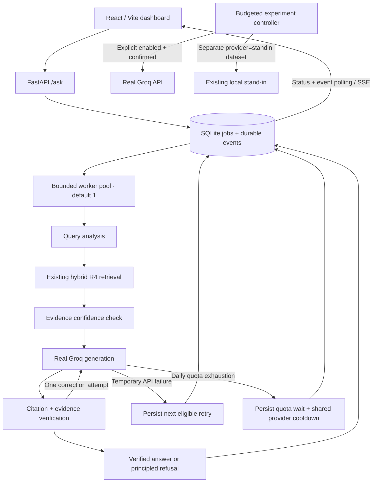

# Durable requests and observability

The Relay v2 upgrades the existing application in this repository. It retains PDF ingestion, R1–R5 search, R4 by default, Groq generation, deterministic citation checks, evidence verification, and one correction attempt. No stand-in model is substituted for Groq. Direct callers of `run_pipeline(question)` (including the existing evaluation scripts) retain their synchronous interface.



## Install and start

From the repository root:

```bash
python3 -m venv venv
source venv/bin/activate
pip install -r requirements.txt
# If configuring a fresh checkout only:
cp .env.example .env
# Edit .env with your own Groq key. Never put it in frontend configuration.
npm --prefix frontend install
npm --prefix frontend run build
uvicorn main:app --host 127.0.0.1 --port 8000
```

Open **http://127.0.0.1:8000**. The built frontend is served by FastAPI. Python 3.10+ and Node 20.19+ (or a compatible recent Node release) are expected. Existing embeddings and FAISS metadata must exist before the first research request; ingestion commands in the root README still apply. Application and worker startup do not download models or send provider requests. The retriever loads on first processing.

For frontend development, keep the backend running and use:

```bash
npm --prefix frontend run dev
```

Open **http://127.0.0.1:5173**. Vite proxies API paths to port 8000. Frontend polling defaults to 2 seconds; Settings supports 1–30 seconds. Event IDs deduplicate incremental results; reconnects replay durable events. No browser progress is invented. Inactive stages on a finished job are marked skipped with “No stage event recorded.” Durations only appear when observed. Chat is single-turn RAG: history selects saved questions; it does not inject prior conversation into retrieval.

By default the API starts a worker in its lifespan. To run it separately:

```bash
QUEUE_INLINE_WORKER=false uvicorn main:app --host 127.0.0.1 --port 8000
# Separate terminal, same working directory / .env / database / queue settings:
python -m reliability.worker
```

Use one worker process initially. All claimers must use the same concurrency setting and database. Graceful shutdown stops new claims and lets active calls finish. Process death leaves leases to expire; the next worker recovers them.

The isolated simulator remains:

```bash
uvicorn simulator.standin_server:app --host 127.0.0.1 --port 8002
```

## SQLite schema and state

| Table | Purpose and fields |
| --- | --- |
| `jobs` | UUID `id`, original `question`, `status`, Unix UTC `created`/`updated`, processing `attempts`, `next_run`, sanitized `error_category`/`error_message`, JSON `result`, JSON `metadata`, unique optional `idempotency_key`, private `lease`/`lease_until`/`owner`, first `started`, terminal `completed`, `reset_estimated` |
| `events` | Monotonic integer `id`, `job_id`, Unix UTC `timestamp`, `stage`, `state`, JSON operational `data`. Includes retrieved evidence and each physical Groq attempt, never private model reasoning. |
| `controls` | Shared `provider_not_before` timestamp prevents another worker immediately hitting a known quota limit. |
| `workers` | Worker UUID and heartbeat. Online means heartbeat within 15 seconds; it does not imply a successful Groq connection. |
| `experiments` | Run UUID, created/status, JSON configuration/rows/summary, stop flag, absolute runtime deadline, sanitized error/stop reason. Interrupted tests never auto-resume. |

WAL mode and `BEGIN IMMEDIATE` transactions serialize admission, capacity checks, claims and transitions. A unique lease token fences late events/results from an expired worker. Active jobs are bounded by `QUEUE_CAPACITY`. Historical completed records remain available; plan explicit archival for a long-running deployment. Use a local SQLite-capable disk. Some network/external filesystems do not reliably support SQLite locking; production can set an absolute local `QUEUE_DATABASE` path.

States: `pending → processing → completed | failed | waiting_for_quota | retry_scheduled`. Eligible scheduled jobs return to `processing`; pending/scheduled jobs can become `cancelled`. A completed job can contain a refused research answer (`refused_correctly` or `verification_failed`); that differs from an operational failure.

Question, model, retrieval settings and pipeline version are stored for resumption. Corpus/model artifacts and Python dependencies must be retained separately to reproduce a run; the queue is not a corpus snapshot. API keys and operator tokens are never stored in SQLite.

## Retry and quota recovery

The Groq client still has three API attempts by default, 2-second initial backoff, 30-second exponential cap and a 30-second maximum inline provider wait. SDK automatic retries remain disabled. API retries, whole-job processing attempts and verifier correction attempts are separate metrics.

Temporary 429s use provider reset/Retry-After information; excessive or unknown waits defer to SQLite. A daily TPD response is never immediately retried by the SDK wrapper. Explicit daily reset headers, Retry-After (seconds or HTTP date), or a provider “try again in” duration schedule the job. Daily resets support relative durations, epoch timestamps and ISO timestamps. Generic minute token reset headers are **not** treated as daily recovery evidence. Without reliable daily reset information, `QUEUE_QUOTA_FALLBACK_SECONDS` schedules an **estimated retry**, default 24 hours; no midnight reset is assumed.

The worker polls SQLite, not Groq, while waiting. A shared cooldown pauses all new real RAG claims until the expected retry window. Only a successful actual Groq response emits `quota_recovery`. A timestamp reaching its deadline is not proof of recovery. Repeated daily exhaustion reschedules within the job attempt limit. 401/403 and permanent 4xx errors fail without automatic queue retries. Whole-job attempts are capped, including interrupted attempts; exhausted jobs require a new user submission.

This is **at-least-once processing**, not exactly-once provider execution. Network timeouts, process death after a billed call, or lease expiry may cause another provider call. Retrying a full pipeline can repeat generation when verification failed because of an API outage. Idempotency keys deduplicate job creation, not remote Groq execution. Active requests cannot be cancelled at the provider; cancellation is rejected with 409 once processing starts.

## API contract

All timestamps below are Unix UTC seconds. Pages use browser-local formatting. Interactive request schemas are also available at `/docs`. Protected endpoints require `Authorization: Bearer <RELAY_ADMIN_TOKEN>` when configured.

| Method / route | Request | Response |
| --- | --- | --- |
| `POST /ask` | `{question: string (1–2000), wait_seconds?: number (0–30)}`, optional `Idempotency-Key` header (max 128 chars) | Default 202 with job object + `job_id`, status/message, `Location`. If `wait_seconds>0` and completed in time: 200 legacy result plus `job_id`/`job_status`. Queue full: 503. Conflicting key: 409. |
| `GET /jobs` | `status?`, `search?` (ID substring), `limit=25` (1–100), `offset=0` | `{items: Job[], total, limit, offset}` |
| `GET /jobs/{id}` | — | Job with `result` when available; 404 if absent. |
| `POST /jobs/{id}/cancel` | — | Cancelled Job; 409 for processing/terminal jobs. |
| `GET /jobs/{id}/events` | `after=0`, optional `stream=true` and `Last-Event-ID` | Default `{items: Event[]}` up to 500; drain pages using last ID. SSE emits `event: lifecycle`, `id`, JSON event; heartbeat comments; terminal stream closes after draining events. Reconnect with the last cursor. |
| `GET /queue/metrics` | — | Status counts, active capacity, waiting age/mean first-claim wait, active jobs/worker processes, next retry, observed Groq calls/latency/tokens/headers. Missing observations are null. |
| `GET /system/metrics` | — | Same dashboard-compatible real-provider telemetry; last 200 observed call records. |
| `GET /system/health` | — | SQLite status, worker heartbeat status, last observed Groq outcome, optional separately labeled stand-in `/metrics`. It makes **no Groq health probe**. |
| `GET /health` | — | Public liveness/database check. Retrieval is explicitly lazy, not claimed initialized. |
| `POST /ask/stream` | Same question schema | Compatibility SSE: job ID followed by completed, verified result or deferred state. Not provider token streaming; use lifecycle events for progress. |
| `POST /experiments/run` | Experiment schema below | Persistent Run, or 400 if not enabled/confirmed or beyond caps. Only one active test across API processes. |
| `GET /experiments/results` | — | `{runs: Run[], files: {filename,provider,url}[]}`. Existing CSVs are preserved. |
| `GET /experiments/{id}` | — | Run, configuration, per-attempt rows and summary. |
| `POST /experiments/{id}/stop` | — | Stop flag: prevents future admissions, active HTTP calls may finish. |
| `GET /experiments/{id}/csv` | `summary=false` | Download per-attempt or summary CSV. |
| `GET /experiments/files/{filename}` | Existing root results CSV basename | Protected artifact download. |

`Job` contains public columns listed in the schema, parsed `metadata` and `result` objects (or null), and `message`/`job_id`; private lease/owner/idempotency values are excluded. `Event` is `{id,job_id,timestamp,stage,state,data}`. State is pending/running/completed/failed/skipped as observed. `Run` includes `{id,created,status,config,rows,summary,stop,deadline,error}`. Experiment statuses include `dry_run`, `running`, `completed`, `stopped`, `interrupted`, `failed`.

Experiment JSON:

```json
{
  "provider": "standin",
  "scenario": "baseline",
  "max_requests": 5,
  "concurrency": 1,
  "max_tokens": 3000,
  "max_runtime_seconds": 30,
  "output_tokens": 64,
  "dry_run": true,
  "confirmed": false
}
```

Providers are `groq` or `standin`; scenarios are `baseline`, `low_concurrency`, `moderate_concurrency`, `rate_limit_observation`, `recovery`. Integer limits must be positive. Stand-in hard caps: 1,000 attempts, 100 concurrency, 1,000,000 estimated tokens, 600 seconds. Real Groq uses the stricter environment caps. Output cap is 256 tokens for both API providers. Baseline/observation/recovery run sequentially; moderate ramps gradually to the requested concurrency. A dry-run validates without sending any provider request.

Example job workflow (add Authorization headers when configured):

```bash
curl -i http://127.0.0.1:8000/ask \
  -H 'Content-Type: application/json' -H 'Idempotency-Key: attention-001' \
  -d '{"question":"How does multi-head attention work?"}'
# HTTP 202; example fields (actual IDs/timestamps are generated):
# {"job_id":"<uuid>","status":"pending","message":"Your request has been received.", ...}
curl http://127.0.0.1:8000/jobs/<uuid>
curl 'http://127.0.0.1:8000/jobs?status=waiting_for_quota&limit=20&offset=0'
curl -N 'http://127.0.0.1:8000/jobs/<uuid>/events?stream=true'
curl -X POST http://127.0.0.1:8000/jobs/<uuid>/cancel
curl http://127.0.0.1:8000/queue/metrics
# A synchronous-compatible response when completion takes less than 30 seconds:
curl http://127.0.0.1:8000/ask -H 'Content-Type: application/json' \
  -d '{"question":"What is positional encoding?", "wait_seconds":30}'
```

When completed, `GET /jobs/{id}` returns `status: completed`, `message: Your answer is ready.`, and `result` with the original pipeline `status`, `question`, `answer`, `sources`, `verification`, `attempts`, `metrics`. Public responses strip raw verifier model output and reasoning fields. A refusal preserves its pipeline status and explanatory answer. Failed jobs include sanitized `error_category` and `error_message`.

## Access and operational limits

This dashboard is for one trusted operator. With no token, protected routes accept only loopback clients while `RELAY_LOCAL_MODE=true`. For shared access, configure a strong `RELAY_ADMIN_TOKEN`, set `RELAY_LOCAL_MODE=false`, terminate HTTPS, and restrict CORS origins. Enter the operator token in dashboard Settings; it is held in sessionStorage, not compiled into assets. Do not place a permissive proxy in front of token-free local mode. Multi-user ownership/tenant authorization is not implemented; do not expose job IDs as a multi-user security boundary. UI errors are rendered as text, not HTML.

Logs are JSON operational events (plus worker startup/error records). Job events carry job IDs and provider attempt request IDs. Evidence and user questions are application data; protect the database accordingly. Secrets are redacted. Private chain-of-thought and raw verifier output are not exposed.

## Configuration additions

Existing `GROQ_*` retry and `RETRIEVAL_*` variables remain in `.env.example`.

| Variable | Default | Meaning |
| --- | --- | --- |
| `QUEUE_DATABASE` | `data/relay.sqlite3` | SQLite path, relative to repo root or absolute local path |
| `QUEUE_CAPACITY` | 200 | Maximum active persisted jobs (completed history excluded) |
| `QUEUE_WORKERS` | 1 | Global simultaneous job limit; 1–16, same on all claimers |
| `QUEUE_POLL_SECONDS` | 1 | SQLite eligibility polling interval |
| `QUEUE_LEASE_SECONDS` | 120 | Crash recovery lease, renewed every ≤5 seconds |
| `QUEUE_MAX_ATTEMPTS` | 5 | Whole-pipeline job attempts, including interrupted attempts |
| `QUEUE_QUOTA_FALLBACK_SECONDS` | 86400 | Estimated daily retry when no reliable reset is supplied |
| `QUEUE_RETRY_SECONDS` | 30 | Estimated retry for temporary failures with no reset |
| `QUEUE_INLINE_WORKER` | true | Start bounded workers inside FastAPI lifespan |
| `RELAY_LOCAL_MODE` | true | Allow token-free loopback use only |
| `RELAY_ADMIN_TOKEN` | empty | Required for shared access; protects jobs/admin/tests/results |
| `CORS_ORIGINS` | localhost/127.0.0.1:5173 | Comma-separated exact permitted browser origins |
| `STANDIN_URL` | http://127.0.0.1:8002 | Server-side isolated simulator URL |
| `GROQ_LOAD_TEST_ENABLED` | false | Required to execute live Groq experiments |
| `GROQ_LOAD_TEST_MAX_REQUESTS` | 20 | Hard cap per real-provider experiment, including retries |
| `GROQ_LOAD_TEST_MAX_CONCURRENCY` | 2 | Maximum in-flight real test calls |
| `GROQ_LOAD_TEST_MAX_TOKENS` | 10000 | Maximum reserved estimated token allowance |
| `GROQ_LOAD_TEST_MAX_RUNTIME_SECONDS` | 300 | Absolute run deadline |

## Controlled live tests (explicit opt-in only)

No live test is run during installation, startup, or automated tests. The command requires explicit request/token/runtime limits even in dry-run:

```bash
python experiments/run_groq_load_tests.py \
  --scenario baseline --max-requests 3 --max-tokens 2000 --max-runtime-seconds 30
```

After reviewing the printed summary, an operator can explicitly approve a live run:

```bash
GROQ_LOAD_TEST_ENABLED=true python experiments/run_groq_load_tests.py \
  --scenario baseline --max-requests 3 --max-tokens 2000 \
  --max-runtime-seconds 30 --concurrency 1 --live --confirm
```

The dashboard additionally requires Review & run and an explicit Groq approval checkbox. Backend environment caps still apply. Queue jobs are paused while an API-controlled Groq experiment runs, and a real experiment is rejected while active queued work or a recorded cooldown exists. The standalone CLI is an independent operator tool: stop/drain your application's Groq work before using it. Neither path coordinates other programs using the same API key.

Each physical HTTP attempt reserves one request and a conservative input allowance (UTF-8 prompt bytes + 256 overhead) plus the output token cap before network access. Retries use the same budgets. Actual returned usage is recorded separately; missing usage remains unavailable, not inferred. Token budgets are estimated safety budgets, not a billing guarantee. Runtime caps apply to in-flight request waits too. Operator stop prevents future calls but cannot revoke a provider call already accepted. In-flight concurrent calls may still finish after another response reveals a quota limit. No daily-exhaustion scenario exists.

429 observation ends the run. Only the `recovery` scenario can retry, up to three attempts, with an explicit numeric Retry-After of at most 30 seconds fitting the remaining runtime/budget. Missing recovery headers stop the run. Daily exhaustion and permanent client/auth failures stop immediately; a test never resumes across a restart or quota reset.

Outputs are unique `results/groq/<run UUID>/results.csv` and `summary.csv`, or `results/standin/<run UUID>/...`. Every row has a `provider` field. Existing CSVs are not overwritten. Request rows include actual response status/latency/usage, available rate headers, per-attempt concurrency/retry metadata and optional queue/API time. TTFT is null/blank because these tests are not streaming. Summary percentiles use observed client latency. Missing failed-call token usage means total consumed tokens is a lower bound and `token_usage_complete=false`. Monitoring Groq metrics describe queued application calls; experiment metrics live in their separate run reports.

## Offline validation

```bash
python -m unittest discover -s test -v
npm --prefix frontend test
npm --prefix frontend run build
```

Backend tests cover original mocked Groq retries, successful/failed pipeline decisions, citations, the one correction attempt, transaction capacity, concurrent submissions/claims, idempotency, cancellation, stale lease fencing, restart persistence, daily quota scheduling and simulated resumption, API lifecycle startup/auth, load budgets, runtime, recovery and CSV output. Frontend tests use mocked API responses for submission, completion/citations/refusal, quota/retry/failure, resumed processing, reconnects, queue refresh/filtering, simple view, confirmation and provider distinction. Mobile CSS and navigation are included; browser smoke verification is documented in the implementation report.

The older root `test_groq.py`, `test_pipeline.py`, `evaluate_answers.py` and retrieval experiment scripts are manual scripts, not offline test discovery targets. The first three make real Groq calls. They were **not run live** during this upgrade. Direct pipeline regression is exercised with mocked provider/retriever responses. Simulated recovery proves scheduler behavior, not real Groq quota recovery.

## Limitations and follow-ups

- SQLite is a single-host initial backend. The queue protocol boundary is ready for a future Redis implementation, but no Redis driver is supplied.
- At-least-once execution can duplicate provider charges after uncertain outcomes. Persisted generation checkpoints/provider-supported idempotency would reduce repeated work.
- Retained jobs/events/experiments need an explicit archival/retention policy. Monitoring currently aggregates retained event history and returns the last 200 calls; very large histories should move to indexed rollups.
- Queue depth charts are live samples from this browser session. Other charts use persisted observed calls; unavailable measurements are labeled N/A. Health is last-observed status, not a continuous Groq connectivity guarantee.
- No live recovery evidence or full real-provider throughput claim is made by mocked tests. Tests do not spend Groq quota.
- Concurrent tests outside this application or a separate CLI using the same key are outside the shared SQLite gate.
- Token/latency/model settings are captured; immutable corpus snapshots and dependency pinning are future reproducibility improvements.
